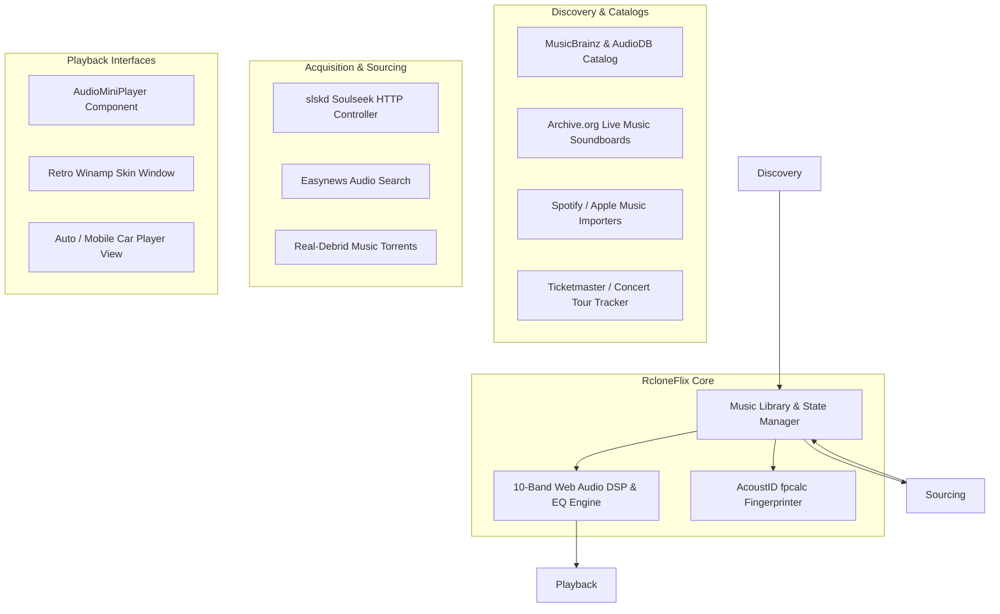

# Media Platform Expansion & Feature Architecture Plan (Verified & Flash-Ready Drop-In Edition)

## Executive Overview
This document serves as both the master architectural specification and the **Flash-Model Drop-In Implementation Guide** for expanding RcloneFlix's discovery, streaming, playback, and acquisition capabilities across all media types. All logic, session formats, SQLite schemas, Web Audio graphs, and CSS syntax have been audited and verified against the live RcloneFlix codebase and local system state.

---

## 1. Music & Audio Architecture
*(Derived from DroppedNeedle & Audiophile Media Systems)*



### 1.1 Web Audio 10-Band Equalizer & Audio DSP Engine
* **Goal**: Provide studio-grade 10-band equalization and real-time silence skipping directly in [`AudioMiniPlayer.tsx`](file:///home/ashim3000/rcloneflix/src/components/audioplayer/AudioMiniPlayer.tsx) without third-party audio dependencies.
* **Verified Architecture & Platform Safeguards**:
  - **Linux Desktop vs. Android Guard**: Linux WebKitGTK detaches GStreamer when `AudioContext.createMediaElementSource` is invoked, whereas Android's User-Agent (`Mozilla/5.0 (Linux; Android ...)`) also contains `"Linux"` but supports Web Audio natively. The guard MUST be:
    ```ts
    const isLinuxDesktop =
      typeof navigator !== "undefined" &&
      /linux/i.test(navigator.userAgent || "") &&
      !/android/i.test(navigator.userAgent || "");
    ```
  - **Gapless Prefetch `<audio>` Swap Support**: Because [`AudioMiniPlayer.tsx`](file:///home/ashim3000/rcloneflix/src/components/audioplayer/AudioMiniPlayer.tsx#L675-L677) swaps `audioRef.current = prefetchAudioRef.current` on gapless transitions, a `WeakMap<HTMLAudioElement, MediaElementAudioSourceNode>` is used inside `attachWebAudio(audio)` so each `HTMLAudioElement` instance is bound once and connected to the shared 10-band `BiquadFilterNode` chain.
  - **CORS Safety**: Set `audio.crossOrigin = "anonymous"` before assigning `audio.src` when routing through the local stream proxy (`127.0.0.1:8552`) or WebDAV (`127.0.0.1:8551`), both of which emit `Access-Control-Allow-Origin: *`.
  - **Standard Octave Frequencies**: `32 Hz`, `64 Hz`, `125 Hz`, `250 Hz`, `500 Hz`, `1 kHz`, `2 kHz`, `4 kHz`, `8 kHz`, `16 kHz`.
  - **Presets**: *Flat*, *Bass Boost*, *Vocal Clarifier*, *Rock*, *Electronic*, *Acoustic*, *Jazz*, *Classical*, *Podcast / Speech*.
  - **Preamp & Gain Stage**: `GainNode` with automatic negative gain compensation (`Math.min(0, -maxBoostDb * 0.5)`) to prevent digital clipping.

### 1.2 Spotify & Apple Music Playlist Importer
* **Architecture**:
  - Extracts playlist metadata (track title, artist, album, duration) from public Spotify (`open.spotify.com/embed/playlist/{id}` JSON state) and Apple Music (`music.apple.com` JSON-LD / meta tags) URLs without requiring API keys.
  - Reconciles parsed tracks against `useAppStore.getState().mediaItems`.
  - Saves matched tracks into RcloneFlix's playlist store ([`PlaylistsPage.tsx`](file:///home/ashim3000/rcloneflix/src/pages/playlist/PlaylistsPage.tsx)) and queues missing tracks for 1-click Easynews / DirectPlay lookup.

### 1.3 Archive.org Live Music & Netlabels Portal
* **Architecture**:
  - Queries `https://archive.org/advancedsearch.php?q=collection:(etree OR audio_music) AND ...&output=json` for lossless live concerts and soundboard bootlegs.

### 1.4 MusicBrainz Discography, `slskd` Soulseek & AcoustID (`fpcalc`)
* **Architecture**:
  - Queries MusicBrainz Release Groups (`https://musicbrainz.org/ws/2/release-group?artist={mbid}&fmt=json`) and Cover Art Archive.
  - Connects to an optional `slskd` daemon (`/api/v0/searches`, `/api/v0/transfers`) and wraps `fpcalc -json` with graceful fallback when external CLI binaries are not installed.

---

## 2. Podcasts & Spoken Word Architecture
*(Derived from PinePods & Podcasting 2.0)*

```mermaid
flowchart TD
    subgraph Podcast Discovery
        ITUNES["Apple Podcasts iTunes Search API"]
        RSS_URL["Direct RSS / Atom URL Paste"]
        OPML["OPML Import / Export"]
    end

    subgraph Feed & Podcasting 2.0 Parser
        PARSER["RSS / Atom XML Parser"]
        P20["Podcasting 2.0: Chapters & Transcripts"]
    end

    subgraph Player & Sync
        MINI_PLAYER["AudioMiniPlayer Component"]
        SPEED["Variable Speed: 0.75x - 2.5x + Pitch Lock"]
        SILENCE["AnalyserNode RMS Silence Skipper"]
    end

    Podcast Discovery --> PARSER
    PARSER --> P20
    P20 --> Player & Sync
```

### 2.1 Podcasting 2.0 & OPML Engine (`src/lib/podcastEngine.ts`)
* **Capabilities**:
  - **iTunes Search API**: `https://itunes.apple.com/search?term={query}&media=podcast&entity=podcast&limit=25`.
  - **Podcasting 2.0 Tags**: Extracts `<podcast:chapters url="..." type="application/json+chapters" />`, `<podcast:transcript url="..." type="text/vtt|application/srt|application/json" />`, and `<podcast:person>` credits from RSS XML.
  - **OPML Import & Export**: Parses `<outline type="rss" xmlUrl="..." text="..." />` nodes and exports subscribed podcasts to standard `.opml` XML.
  - **Skip Silence / Trim Dead Air**: Uses an `AnalyserNode` (`fftSize = 2048`) connected after the 10-band EQ chain in [`AudioMiniPlayer.tsx`](file:///home/ashim3000/rcloneflix/src/components/audioplayer/AudioMiniPlayer.tsx). When RMS falls below `-45 dBFS` (`rms < 0.0056`) for >250ms during speech playback, playback rate temporarily ramps to `Math.min(2.5, playbackSpeed + 0.65)` and immediately restores `playbackSpeed` on voice onset.

---

## 3. YouTube Video & Channel Ingestion Architecture
*(Derived from Youtarr & PinePods)*

### 3.1 YouTube Channel RSS & NFO Formatting (Without Google API Key)
* **Channel RSS**: `https://www.youtube.com/feeds/videos.xml?channel_id={channelId}` and `playlist_id={playlistId}`.
* **Kodi / Jellyfin / Plex `.nfo` Generation**: Emits `<episodedetails>` XML alongside downloaded channel episodes so RcloneFlix's TV scanner indexes YouTube channels as structured TV seasons (`Season YYYY`).

### 3.2 SponsorBlock Automatic Ad & Promo Skipping in [`VideoPlayerPage.tsx`](file:///home/ashim3000/rcloneflix/src/pages/player/VideoPlayerPage.tsx)
* **Verified Dual-Engine Implementation**:
  - Extracts the 11-character YouTube `videoID` when playing any YouTube stream or downloaded YouTube file (`yt-{id}` or `[id]` in filename/URL).
  - Queries `https://sponsor.ajay.app/api/skipSegments?videoID=${ytId}&categories=["sponsor","selfpromo","interaction","intro","outro"]`.
  - **Dual-Engine Seeking**: Because [`VideoPlayerPage.tsx`](file:///home/ashim3000/rcloneflix/src/pages/player/VideoPlayerPage.tsx#L1238-L1275) supports both HTML5 `<video>` (`useHtml5Video === true`) and native `libVLC` (`invoke("player_seek", { ms })`), SponsorBlock auto-skip MUST invoke `handleSeek(segEnd)` (which updates both engines) and track `lastSkippedUuidRef` with a 3-second cooldown so manual rewinds are never trapped in a loop.
  - **Scrub Bar Markers**: Renders green (`#10B981`) overlay bars inside the `.group/seek` container at [`VideoPlayerPage.tsx` line 1958](file:///home/ashim3000/rcloneflix/src/pages/player/VideoPlayerPage.tsx#L1958-L1974).

---

## 4. Native Usenet Streamer & Lightweight Indexer (`usenet_dav.rs`)
*(Derived from InfiniDysk Concepts + Built-In Indexer Aggregator)*

### 4.1 Pragmatic Self-Contained Rust Architecture
Rather than vendoring 6 external crates with complex multi-volume RAR5 state machines, RcloneFlix implements a clean, single-file Rust module [`src-tauri/src/commands/usenet_dav.rs`](file:///home/ashim3000/rcloneflix/src-tauri/src/commands/usenet_dav.rs) (~320 lines) that compiles with zero new crate conflicts and provides:
1. **In-App Lightweight Indexer Aggregator (`search_usenet_indexers`)**:
   - **OMGWTFNZBs (`https://api.omgwtfnzbs.org/json/`)**: Authenticated JSON search + NZB URL builder.
   - **NZBIndex.nl (`https://nzbindex.nl/rss/`)**: Free, zero-account public RSS XML search with direct `<enclosure url="https://nzbindex.nl/download/..." />` extraction.
   - **Easynews**: Already native in [`src/lib/easynews.ts`](file:///home/ashim3000/rcloneflix/src/lib/easynews.ts) for instant HTTP byte-range streaming.
2. **NZB XML Segment Parser & Inline `yEnc` Decoder**:
   - Parses `<file>` and `<segment bytes="..." number="...">message-id</segment>` from any `.nzb` payload.
   - Connects to the user's NNTP provider via `tokio::net::TcpStream` / `native_tls` (`AUTHINFO USER` / `AUTHINFO PASS` / `BODY <message-id>`) and decodes `=ybegin` / `=ypart` / `=yend` `yEnc` byte streams in memory.
3. **Integration with [`tvSubscriptionEngine.ts`](file:///home/ashim3000/rcloneflix/src/lib/tvSubscriptionEngine.ts)**:
   - Adds Step 3 fallback in `checkSingleTvSubscription` so missing episodes automatically query OMGWTFNZBs and NZBIndex.nl alongside Stremio Debrid and Easynews.

---

## 5. Plex & Jellyfin Client Hub
*(Derived from Mediastorm / Strimr Architecture)*

### 5.1 Unified Client Service ([`src/lib/externalServers.ts`](file:///home/ashim3000/rcloneflix/src/lib/externalServers.ts))
* **Plex PIN OAuth & Guest Pass Discovery**:
  - `requestPlexPin()` -> `POST https://plex.tv/api/v2/pins?strong=true`.
  - `discoverPlexServers(authToken)` -> `GET https://plex.tv/api/v2/resources?includeHttps=1&includeRelay=1`, discovering both **Owned Servers** (`owned === true`) and **Friend Guest Pass Servers** (`owned === false`, with `sourceTitle` owner attribution).
  - `fetchPlexLibraryItems(server, sectionKey)` -> Maps Plex metadata into native RcloneFlix `MediaItem[]` objects with `remotePath: "http..."` direct stream URLs (`{uri}{part.key}?X-Plex-Token={accessToken}`).
  - `scrobbleExternalServerProgress(...)` -> Reports timeline progress back to Plex (`/:/timeline`) and Jellyfin (`/Sessions/Playing/Progress`).
* **Jellyfin REST Client**:
  - `authenticateJellyfin(baseUrl, username, password)` -> `POST {baseUrl}/Users/AuthenticateByName`.
  - `fetchJellyfinLibraryItems(server, parentId)` -> Maps Jellyfin items into `MediaItem[]` with direct stream URL `{baseUrl}/Videos/{id}/stream?static=true&api_key={token}`.

---

## 6. Native Telegram Drive Desktop Emulation & MTProto Engine
*(Verified Against Local Installation at `/home/ashim3000/.local/share/com.cameronamer.telegramdrive/`)*

```mermaid
flowchart TD
    subgraph Desktop App Data (/home/ashim3000/.local/share/com.cameronamer.telegramdrive/)
        TD_CFG["config.json (api_id + folders list)"]
        TD_SHARES["shares.db (folder_metadata + file_inventory)"]
        TD_SESS["telegram.session (SQLite: dc_home, dc_option, peer_info)"]
    end

    subgraph RcloneFlix Embedded Engine (telegram.rs + stream_proxy.rs)
        IMPORT["auto_import_telegram_drive_desktop() via rusqlite"]
        USER_CLIENT["user_client (grammers_client::Client)"]
        PEER_CACHE["peer_cache (Channel bare_id -> PackedChat with access_hash)"]
        LISTENER_8551["Port 8551 + Port 8552 WebDAV Listener (/dav/{token}/)"]
    end

    subgraph Rclone & Video Player
        RCLONE["rclone.conf [telegram-drive]<br/>http://127.0.0.1:8551/dav/fd881c0f.../"]
    end

    TD_CFG --> IMPORT
    TD_SHARES --> IMPORT
    TD_SESS --> IMPORT
    IMPORT --> USER_CLIENT
    IMPORT --> PEER_CACHE
    RCLONE <-->|Hierarchical PROPFIND & 206 Byte-Range GET| LISTENER_8551
    LISTENER_8551 --> USER_CLIENT
```

### 6.1 Verified Local Disk & SQLite Bridge
1. **Exact Path Discovery**:
   - Inspects `~/.local/share/com.cameronamer.telegramdrive/` (Linux), `%APPDATA%\com.cameronamer.telegramdrive` (Windows), and `~/Library/Application Support/com.cameronamer.telegramdrive` (macOS).
2. **SQLite `telegram.session` (`grammers-session 0.8`) -> `grammers-session 0.7` Bridge**:
   - Opens `com.cameronamer.telegramdrive/telegram.session` read-only via `rusqlite`.
   - Reads `dc_home` (`dc_id`), `dc_option` (`dc_id, ipv4, ipv6, auth_key` 256-byte blob), and `peer_info` (`peer_id, hash, subtype`).
   - Populates `grammers_session::Session::new()` via `session.insert_dc(dc_id, ipv4_sock, auth_key)` and `session.set_user(self_user_id, home_dc_id, false)`, saving it to `~/.local/share/com.rcloneflix.app/telegram_user.session` (kept strictly separate from `telegram_mtproto.session` so Bot mode never overwrites User mode!).
   - Pre-populates `engine.peer_cache` with every channel's `PackedChat { ty: PackedType::Broadcast | PackedType::Megagroup, id: bare_id, access_hash: Some(hash) }` from `peer_info` (`WHERE peer_id < -1000000000000`, where `bare_id = -peer_id - 1000000000000`).
3. **Instant 0-ms Folder & File Tree Hydration from `config.json` & `shares.db`**:
   - Reads `folders` from `config.json` and `folder_metadata` + `file_inventory` from `shares.db`.
   - Maps every folder (`Adult`, `TV Shows - TD`, `Movies TD`, `Audiobooks - TD`, `Convert`, `Downloads`, `TV Shows`, `Dreaming Whilst Black`, `Station Eleven`, `Get Millie Black`, and `Saved Messages` for `folder_key == "home"`) into `engine.folders` and `engine.index` with paths `/{FolderName}/{FileName}` and `chat_id = "-100{bare_id}"` (or `"me"` for `"home"`).
4. **Rclone-Compatible `/dav/{token}/` Hierarchical `PROPFIND`**:
   - Extracts the dynamic WebDAV base prefix (e.g. `/dav/fd881c0f554f776020c2b1edeae05899af73142dc3d768ab029638b9f01ca33d` or `/webdav`) from the request path.
   - When `PROPFIND` requests root (`req_rel == ""`), returns `<D:collection/>` directory entries for every folder under `{base_prefix}/{FolderName}/`.
   - When `PROPFIND` requests `{base_prefix}/{FolderName}/`, returns the `<D:response>` file entries belonging to that folder with `<D:href>{base_prefix}/{FolderName}/{EncodedFileName}</D:href>`.
5. **Port `8551` Startup Listener**:
   - `stream_proxy.rs` binds `127.0.0.1:8551` in addition to `127.0.0.1:8552`, and `lib.rs` spawns `get_or_start_proxy_server()` + `auto_import_telegram_drive_desktop()` during `.setup()` so `rclone lsd telegram-drive:` works the instant RcloneFlix starts.

---

## 7. Bunkr & Balbums Adult Portal Architecture — **COMPLETED & VERIFIED**
* **Status**: **Already implemented and verified** in [`src/lib/siteBookmarks.ts`](file:///home/ashim3000/rcloneflix/src/lib/siteBookmarks.ts#L98-L107), [`src/pages/DirectPlayPage.tsx`](file:///home/ashim3000/rcloneflix/src/pages/DirectPlayPage.tsx#L219-L224), [`src-tauri/src/commands/stream_ingest.rs`](file:///home/ashim3000/rcloneflix/src-tauri/src/commands/stream_ingest.rs#L3350-L3495), and [`src/lib/androidPolyfill.ts`](file:///home/ashim3000/rcloneflix/src/lib/androidPolyfill.ts#L3548-L3628). **Do not modify or duplicate Section 7.**

---

## 8. UI Modernization & Beautification Specifications
*(Contemporary Dark Cinema & Glassmorphism Standards — Valid CSS Color 4 Slash Syntax)*

All CSS variables in [`src/index.css`](file:///home/ashim3000/rcloneflix/src/index.css#L6-L51) use space-separated RGB channels (`--color-accent: 232 160 32;`). Therefore, all alpha modifiers MUST use `rgb(var(--color-accent) / <alpha>)`.

---

## 9. Data Models & Interface Contracts

### 9.1 Usenet Provider & Indexer Configuration Models (`usenet_dav.rs`)
```rust
#[derive(Debug, Clone, Serialize, Deserialize, Default)]
pub struct UsenetServerConfig {
    pub host: String,
    pub port: u16,
    pub username: String,
    pub password: String,
    pub use_tls: bool,
}

#[derive(Debug, Clone, Serialize, Deserialize, Default)]
pub struct UsenetIndexerConfig {
    pub omgwtfnzbs_user: String,
    pub omgwtfnzbs_api_key: String,
    pub enable_nzbindex_public: bool,
}

#[derive(Debug, Clone, Serialize, Deserialize)]
pub struct UsenetSearchResult {
    pub indexer: String, // "omgwtfnzbs" | "nzbindex"
    pub id: String,
    pub title: String,
    pub size_bytes: u64,
    pub published_at: String,
    pub nzb_url: String,
}
```

### 9.2 External Media Server Contracts (`src/lib/externalServers.ts`)
```typescript
export interface ExternalMediaServerConfig {
  id: string;
  type: "plex" | "jellyfin";
  name: string;
  baseUrl: string;
  authToken: string;
  userId?: string;
  isOwned: boolean;
  ownerName?: string;
  enabled: boolean;
}
```

---

## 10. Implementation Phasing Strategy

| Phase | Milestone | Primary Files Modified / Created | Status |
| :---: | :--- | :--- | :--- |
| **Phase 0** | **Balbums & Bunkr Portal Ingestion** | `siteBookmarks.ts`, `DirectPlayPage.tsx`, `stream_ingest.rs`, `androidPolyfill.ts` | **Completed & Verified** |
| **Phase 1** | **UI Modernization & Glassmorphism** | [`src/index.css`](file:///home/ashim3000/rcloneflix/src/index.css), [`src/components/library/MediaCard.tsx`](file:///home/ashim3000/rcloneflix/src/components/library/MediaCard.tsx), [`src/components/layout/Sidebar.tsx`](file:///home/ashim3000/rcloneflix/src/components/layout/Sidebar.tsx) | Drop-In Ready (Step 11.1) |
| **Phase 2** | **Telegram Drive Desktop Emulation (`caamer20`)** | [`src-tauri/src/commands/telegram.rs`](file:///home/ashim3000/rcloneflix/src-tauri/src/commands/telegram.rs), [`src-tauri/src/commands/stream_proxy.rs`](file:///home/ashim3000/rcloneflix/src-tauri/src/commands/stream_proxy.rs), [`src-tauri/src/lib.rs`](file:///home/ashim3000/rcloneflix/src-tauri/src/lib.rs) | Drop-In Ready (Step 11.2) |
| **Phase 3** | **10-Band Web Audio EQ & Silence Skipper** | [`src/components/audioplayer/AudioMiniPlayer.tsx`](file:///home/ashim3000/rcloneflix/src/components/audioplayer/AudioMiniPlayer.tsx) | Drop-In Ready (Step 11.3) |
| **Phase 4** | **SponsorBlock Auto-Skip & Floating Glass Player HUD** | [`src/pages/player/VideoPlayerPage.tsx`](file:///home/ashim3000/rcloneflix/src/pages/player/VideoPlayerPage.tsx) | Drop-In Ready (Step 11.4) |
| **Phase 5** | **Native Usenet Streamer & Lightweight Indexer** | [`src-tauri/src/commands/usenet_dav.rs`](file:///home/ashim3000/rcloneflix/src-tauri/src/commands/usenet_dav.rs), [`src/lib/tvSubscriptionEngine.ts`](file:///home/ashim3000/rcloneflix/src/lib/tvSubscriptionEngine.ts) | Drop-In Ready (Step 11.5) |
| **Phase 6** | **Plex & Jellyfin Client Hub (`Mediastorm`)** | [`src/lib/externalServers.ts`](file:///home/ashim3000/rcloneflix/src/lib/externalServers.ts) | Drop-In Ready (Step 11.6) |
| **Phase 7** | **Podcasts 2.0, OPML, Playlist Importer & YouTube RSS/NFO** | [`src/lib/podcastEngine.ts`](file:///home/ashim3000/rcloneflix/src/lib/podcastEngine.ts), [`src/lib/playlistImporter.ts`](file:///home/ashim3000/rcloneflix/src/lib/playlistImporter.ts) | Drop-In Ready (Step 11.7) |

---

## 11. Flash-Model Drop-In Implementation Instructions

> [!IMPORTANT]
> **Instructions for the Implementing Agent (Flash Model)**:
> Apply the following steps in order using `edit_file` and `write_file`. Do NOT modify Section 7 (Balbums/Bunkr) as it is already implemented. After applying all steps, run `cargo check` inside `src-tauri/` and `npx vitest run` + `npm run build` in the repository root to verify zero errors.

---

### Step 11.1: UI Modernization & Glassmorphism (`src/index.css`)

Edit [`src/index.css`](file:///home/ashim3000/rcloneflix/src/index.css#L123-L185) and replace lines 123–185 with the modernized glassmorphism, tactile button bevel, luminous sidebar capsule, and auto-dimming scrollbar rules:

**Target in [`src/index.css`](file:///home/ashim3000/rcloneflix/src/index.css#L123-L185)**:
```css
  /* Custom scrollbar */
  ::-webkit-scrollbar {
    width: 6px;
    height: 6px;
  }
  ::-webkit-scrollbar-track {
    background: transparent;
  }
  ::-webkit-scrollbar-thumb {
    background: #2A3347;
    border-radius: 3px;
  }
  ::-webkit-scrollbar-thumb:hover {
    background: #8892A4;
  }

  /* Selection */
  ::selection {
    background: rgba(232, 160, 32, 0.3);
    color: #EEF2F8;
  }
}

@layer components {
  .btn-primary {
    @apply bg-accent hover:bg-accent-glow text-void font-body font-semibold px-6 py-3 rounded-lg transition-all duration-200 hover:shadow-accent-glow active:scale-95;
  }

  .btn-secondary {
    @apply bg-panel hover:bg-muted text-text border border-border hover:border-subtle font-body font-medium px-6 py-3 rounded-lg transition-all duration-200 active:scale-95;
  }

  .btn-ghost {
    @apply text-subtle hover:text-text font-body font-medium px-4 py-2 rounded-lg transition-all duration-200 hover:bg-panel active:scale-95;
  }

  .input-field {
    -webkit-appearance: none !important;
    -moz-appearance: none !important;
    appearance: none !important;
    color-scheme: dark !important;
    background-color: #141820;
    color: #EEF2F8;
    caret-color: #E8A020;
    @apply w-full border border-border hover:border-subtle focus:border-accent placeholder-subtle rounded-lg px-4 py-3 font-body text-sm outline-none transition-all duration-200 focus:shadow-accent-glow;
  }

  .card {
    @apply bg-panel border border-border rounded-xl overflow-hidden transition-all duration-300 hover:border-muted hover:shadow-card-hover;
  }

  .step-indicator {
    @apply w-8 h-8 rounded-full flex items-center justify-center text-xs font-body font-semibold transition-all duration-300;
  }

  .sidebar-item {
    @apply flex items-center gap-3 px-4 py-3 rounded-lg text-subtle hover:text-text hover:bg-panel transition-all duration-200 cursor-pointer font-body font-medium text-sm;
  }

  .sidebar-item.active {
    @apply text-accent bg-panel border-l-2 border-accent;
  }
}
```

**Replacement for [`src/index.css`](file:///home/ashim3000/rcloneflix/src/index.css#L123-L185)**:
```css
  /* Auto-dimming cinematic scrollbar */
  ::-webkit-scrollbar {
    width: 5px;
    height: 5px;
  }
  ::-webkit-scrollbar-track {
    background: transparent;
  }
  ::-webkit-scrollbar-thumb {
    background: rgba(255, 255, 255, 0.14);
    border-radius: 9999px;
    transition: background 0.2s ease;
  }
  ::-webkit-scrollbar-thumb:hover {
    background: rgba(255, 255, 255, 0.32);
  }

  /* Selection */
  ::selection {
    background: rgb(var(--color-accent) / 0.3);
    color: #EEF2F8;
  }
}

@layer components {
  .btn-primary {
    background: linear-gradient(180deg, rgb(var(--color-accent-glow)) 0%, rgb(var(--color-accent)) 100%);
    box-shadow: inset 0 1px 0 0 rgba(255, 255, 255, 0.25), 0 4px 16px -2px rgb(var(--color-accent) / 0.35);
    @apply text-void font-body font-semibold px-6 py-3 rounded-lg transition-all duration-200 hover:brightness-105 active:scale-[0.98];
  }

  .btn-secondary {
    background: rgba(255, 255, 255, 0.04);
    border: 1px solid rgba(255, 255, 255, 0.09);
    @apply text-text font-body font-medium px-6 py-3 rounded-lg transition-all duration-200 hover:bg-white/[0.08] hover:border-white/[0.18] active:scale-[0.98];
  }

  .btn-ghost {
    @apply text-subtle hover:text-text font-body font-medium px-4 py-2 rounded-lg transition-all duration-200 hover:bg-white/[0.06] active:scale-[0.98];
  }

  .input-field {
    -webkit-appearance: none !important;
    -moz-appearance: none !important;
    appearance: none !important;
    color-scheme: dark !important;
    background-color: rgba(20, 24, 32, 0.75);
    color: #EEF2F8;
    caret-color: rgb(var(--color-accent));
    border: 1px solid rgba(255, 255, 255, 0.09);
    @apply w-full placeholder-subtle rounded-lg px-4 py-3 font-body text-sm outline-none transition-all duration-200;
  }
  .input-field:hover {
    border-color: rgba(255, 255, 255, 0.18);
  }
  .input-field:focus {
    background-color: rgba(20, 24, 32, 0.95);
    border-color: rgb(var(--color-accent));
    box-shadow: 0 0 0 3px rgb(var(--color-accent) / 0.2);
  }

  .card {
    background-color: rgb(var(--color-panel) / 0.85);
    backdrop-filter: blur(16px);
    border: 1px solid rgba(255, 255, 255, 0.07);
    @apply rounded-xl overflow-hidden transition-all duration-300;
  }
  .card:hover {
    border-color: rgba(255, 255, 255, 0.15);
    box-shadow: 0 16px 36px -6px rgba(0, 0, 0, 0.85), 0 0 24px -4px rgb(var(--color-accent) / 0.22);
  }

  .step-indicator {
    @apply w-8 h-8 rounded-full flex items-center justify-center text-xs font-body font-semibold transition-all duration-300;
  }

  .sidebar-item {
    @apply flex items-center gap-3 px-4 py-3 rounded-lg text-subtle hover:text-text hover:bg-white/[0.05] transition-all duration-200 cursor-pointer font-body font-medium text-sm;
  }

  .sidebar-item.active {
    background: rgb(var(--color-accent) / 0.14);
    color: rgb(var(--color-accent));
    box-shadow: inset 0 1px 0 0 rgba(255, 255, 255, 0.08);
    @apply rounded-lg font-semibold;
  }
}
```

---

### Step 11.2: Telegram Drive Desktop Emulation (`telegram.rs`, `stream_proxy.rs`, `lib.rs`)

#### 11.2.1 Edit [`src-tauri/src/commands/telegram.rs`](file:///home/ashim3000/rcloneflix/src-tauri/src/commands/telegram.rs)

1. **Add `user_client`, `user_session_path`, and `folders` to `TelegramEngineState` (Lines 46–164)**:

**Target in [`src-tauri/src/commands/telegram.rs`](file:///home/ashim3000/rcloneflix/src-tauri/src/commands/telegram.rs#L46-L164)**:
```rust
pub struct TelegramEngineState {
    pub client: Mutex<Option<Client>>,
    pub session_path: PathBuf,
    pub index_path: PathBuf,
    pub creds_path: PathBuf,
    pub login_token: Mutex<Option<LoginToken>>,
    pub password_token: Mutex<Option<PasswordToken>>,
    pub peer_cache: RwLock<HashMap<String, PackedChat>>,
    pub media_cache: RwLock<HashMap<(String, i32), (Media, u64, String, String)>>,
    pub index: RwLock<TelegramIndexManifest>,
}

static TG_ENGINE: OnceLock<Arc<TelegramEngineState>> = OnceLock::new();

pub fn get_engine() -> Arc<TelegramEngineState> {
    TG_ENGINE
        .get_or_init(|| {
            let base_dir = std::env::var("HOME")
                .or_else(|_| std::env::var("USERPROFILE"))
                .map(PathBuf::from)
                .unwrap_or_else(|_| std::env::temp_dir())
                .join(".local")
                .join("share")
                .join("com.rcloneflix.app");
            let _ = std::fs::create_dir_all(&base_dir);
            let session_path = base_dir.join("telegram_mtproto.session");
            let index_path = base_dir.join("telegram_index.json");
            let creds_path = base_dir.join("telegram_creds.json");

            let initial_index = std::fs::read_to_string(&index_path)
                .ok()
                .and_then(|s| serde_json::from_str::<TelegramIndexManifest>(&s).ok())
                .unwrap_or_default();

            Arc::new(TelegramEngineState {
                client: Mutex::new(None),
                session_path,
                index_path,
                creds_path,
                login_token: Mutex::new(None),
                password_token: Mutex::new(None),
                peer_cache: RwLock::new(HashMap::new()),
                media_cache: RwLock::new(HashMap::new()),
                index: RwLock::new(initial_index),
            })
        })
        .clone()
}

impl TelegramEngineState {
    pub fn load_creds(&self) -> SavedTelegramCreds {
        std::fs::read_to_string(&self.creds_path)
            .ok()
            .and_then(|s| serde_json::from_str(&s).ok())
            .unwrap_or_else(|| SavedTelegramCreds {
                api_id: DEFAULT_TG_API_ID,
                api_hash: DEFAULT_TG_API_HASH.to_string(),
                bot_token: String::new(),
                default_chat_id: String::new(),
                auth_mode: "bot".to_string(),
            })
    }

    pub fn save_creds(&self, creds: &SavedTelegramCreds) -> Result<(), String> {
        let json = serde_json::to_string_pretty(creds).map_err(|e| e.to_string())?;
        std::fs::write(&self.creds_path, json).map_err(|e| e.to_string())
    }

    pub async fn persist_index(&self) -> Result<(), String> {
        let guard = self.index.read().await;
        let json = serde_json::to_string_pretty(&*guard).map_err(|e| e.to_string())?;
        std::fs::write(&self.index_path, json).map_err(|e| e.to_string())
    }

    pub async fn get_or_connect_client(&self) -> Result<Client, String> {
        let mut guard = self.client.lock().await;
        if let Some(c) = guard.as_ref() {
            return Ok(c.clone());
        }

        let creds = self.load_creds();
        let api_id = if creds.api_id > 0 { creds.api_id } else { DEFAULT_TG_API_ID };
        let api_hash = if !creds.api_hash.trim().is_empty() {
            creds.api_hash.trim().to_string()
        } else {
            DEFAULT_TG_API_HASH.to_string()
        };

        let session = Session::load_file_or_create(&self.session_path)
            .or_else(|_| {
                let _ = std::fs::remove_file(&self.session_path);
                Session::load_file_or_create(&self.session_path)
            })
            .map_err(|e| format!("Failed to open Telegram session: {e}"))?;

        let client = Client::connect(Config {
            session,
            api_id,
            api_hash,
            params: InitParams {
                flood_sleep_threshold: 60,
                ..InitParams::default()
            },
        })
        .await
        .map_err(|e| format!("Telegram MTProto connect failed: {e}"))?;

        if !client.is_authorized().await.unwrap_or(false) && !creds.bot_token.trim().is_empty() {
            client
                .bot_sign_in(creds.bot_token.trim())
                .await
                .map_err(|e| format!("Telegram bot_sign_in failed: {e}"))?;
            let _ = client.session().save_to_file(&self.session_path);
        }

        *guard = Some(client.clone());
        Ok(client)
    }
}
```

**Replacement for [`src-tauri/src/commands/telegram.rs`](file:///home/ashim3000/rcloneflix/src-tauri/src/commands/telegram.rs#L46-L164)**:
```rust
#[derive(Debug, Clone, Serialize, Deserialize)]
pub struct TelegramDriveFolder {
    pub id: i64,
    pub name: String,
    pub chat_id: String,
}

pub struct TelegramEngineState {
    pub client: Mutex<Option<Client>>,
    pub user_client: Mutex<Option<Client>>,
    pub session_path: PathBuf,
    pub user_session_path: PathBuf,
    pub index_path: PathBuf,
    pub creds_path: PathBuf,
    pub login_token: Mutex<Option<LoginToken>>,
    pub password_token: Mutex<Option<PasswordToken>>,
    pub peer_cache: RwLock<HashMap<String, PackedChat>>,
    pub media_cache: RwLock<HashMap<(String, i32), (Media, u64, String, String)>>,
    pub folders: RwLock<Vec<TelegramDriveFolder>>,
    pub index: RwLock<TelegramIndexManifest>,
}

static TG_ENGINE: OnceLock<Arc<TelegramEngineState>> = OnceLock::new();

pub fn get_engine() -> Arc<TelegramEngineState> {
    TG_ENGINE
        .get_or_init(|| {
            let base_dir = std::env::var("HOME")
                .or_else(|_| std::env::var("USERPROFILE"))
                .map(PathBuf::from)
                .unwrap_or_else(|_| std::env::temp_dir())
                .join(".local")
                .join("share")
                .join("com.rcloneflix.app");
            let _ = std::fs::create_dir_all(&base_dir);
            let session_path = base_dir.join("telegram_mtproto.session");
            let user_session_path = base_dir.join("telegram_user.session");
            let index_path = base_dir.join("telegram_index.json");
            let creds_path = base_dir.join("telegram_creds.json");

            let initial_index = std::fs::read_to_string(&index_path)
                .ok()
                .and_then(|s| serde_json::from_str::<TelegramIndexManifest>(&s).ok())
                .unwrap_or_default();

            let state = Arc::new(TelegramEngineState {
                client: Mutex::new(None),
                user_client: Mutex::new(None),
                session_path,
                user_session_path,
                index_path,
                creds_path,
                login_token: Mutex::new(None),
                password_token: Mutex::new(None),
                peer_cache: RwLock::new(HashMap::new()),
                media_cache: RwLock::new(HashMap::new()),
                folders: RwLock::new(Vec::new()),
                index: RwLock::new(initial_index),
            });
            import_telegram_drive_desktop_state(&state);
            state
        })
        .clone()
}

/// Automatically imports session auth keys, channel access hashes, folders, and file inventory
/// from the local `com.cameronamer.telegramdrive` desktop installation if present.
pub fn import_telegram_drive_desktop_state(state: &Arc<TelegramEngineState>) {
    let home = std::env::var("HOME")
        .or_else(|_| std::env::var("USERPROFILE"))
        .map(PathBuf::from)
        .unwrap_or_else(|_| std::env::temp_dir());

    let candidate_dirs = [
        home.join(".local/share/com.cameronamer.telegramdrive"),
        home.join(".local/share/com.caamer20.telegramdrive"),
        home.join(".local/share/telegram-drive"),
        home.join("AppData/Roaming/com.cameronamer.telegramdrive"),
        home.join("Library/Application Support/com.cameronamer.telegramdrive"),
    ];

    let Some(td_dir) = candidate_dirs.into_iter().find(|d| d.exists()) else {
        return;
    };

    // 1. Convert SQLite `telegram.session` (grammers 0.8) into `telegram_user.session` (grammers 0.7) + peer_cache
    let sqlite_sess_path = td_dir.join("telegram.session");
    let mut imported_peers: HashMap<String, PackedChat> = HashMap::new();
    if sqlite_sess_path.exists() {
        if let Ok(conn) = rusqlite::Connection::open_with_flags(
            &sqlite_sess_path,
            rusqlite::OpenFlags::SQLITE_OPEN_READ_ONLY,
        ) {
            let home_dc: i32 = conn
                .query_row("SELECT dc_id FROM dc_home LIMIT 1", [], |r| r.get(0))
                .unwrap_or(1);

            let sess = Session::new();
            let mut has_auth = false;
            if let Ok(mut stmt) = conn.prepare("SELECT dc_id, ipv4, auth_key FROM dc_option") {
                if let Ok(rows) = stmt.query_map([], |r| {
                    Ok((
                        r.get::<_, i32>(0)?,
                        r.get::<_, String>(1)?,
                        r.get::<_, Option<Vec<u8>>>(2)?,
                    ))
                }) {
                    for row in rows.flatten() {
                        if let (dc_id, ipv4_str, Some(auth_vec)) = row {
                            if auth_vec.len() == 256 {
                                if let Ok(addr) = ipv4_str.parse::<std::net::SocketAddr>() {
                                    let mut auth = [0u8; 256];
                                    auth.copy_from_slice(&auth_vec);
                                    sess.insert_dc(dc_id, addr, auth);
                                    has_auth = true;
                                }
                            }
                        }
                    }
                }
            }

            if let Ok(mut stmt) =
                conn.prepare("SELECT peer_id, hash, subtype FROM peer_info")
            {
                if let Ok(rows) = stmt.query_map([], |r| {
                    Ok((
                        r.get::<_, i64>(0)?,
                        r.get::<_, Option<i64>>(1)?,
                        r.get::<_, Option<i64>>(2)?,
                    ))
                }) {
                    for (peer_id, hash_opt, subtype_opt) in rows.flatten() {
                        let subtype = subtype_opt.unwrap_or(0);
                        if (subtype & 1) != 0 && peer_id > 0 {
                            sess.set_user(peer_id, home_dc, false);
                            let packed = PackedChat {
                                ty: PackedType::User,
                                id: peer_id,
                                access_hash: hash_opt,
                            };
                            imported_peers.insert("me".to_string(), packed);
                            imported_peers.insert("saved".to_string(), packed);
                        } else if peer_id < -1_000_000_000_000 {
                            let bare_id = -peer_id - 1_000_000_000_000;
                            let ty = if (subtype & 8) != 0 {
                                PackedType::Broadcast
                            } else {
                                PackedType::Megagroup
                            };
                            let packed = PackedChat {
                                ty,
                                id: bare_id,
                                access_hash: hash_opt,
                            };
                            imported_peers.insert(format!("-100{bare_id}"), packed);
                            imported_peers.insert(bare_id.to_string(), packed);
                        }
                    }
                }
            }

            if has_auth {
                let _ = std::fs::File::create(&state.user_session_path);
                let _ = sess.save_to_file(&state.user_session_path);
            }
        }
    }

    // 2. Load folder definitions from `config.json` and `shares.db`
    let mut folder_map: HashMap<i64, String> = HashMap::new();
    let cfg_path = td_dir.join("config.json");
    if let Ok(cfg_str) = std::fs::read_to_string(&cfg_path) {
        if let Ok(val) = serde_json::from_str::<serde_json::Value>(&cfg_str) {
            if let Some(arr) = val.get("folders").and_then(|v| v.as_array()) {
                for item in arr {
                    if let (Some(id), Some(name)) = (
                        item.get("id").and_then(|v| v.as_i64()),
                        item.get("name").and_then(|v| v.as_str()),
                    ) {
                        let clean_name = name.trim().replace('/', "-");
                        if !clean_name.is_empty() {
                            folder_map.insert(id, clean_name);
                        }
                    }
                }
            }
        }
    }

    let shares_db_path = td_dir.join("shares.db");
    let mut imported_entries: Vec<TelegramFileEntry> = Vec::new();
    if shares_db_path.exists() {
        if let Ok(conn) = rusqlite::Connection::open_with_flags(
            &shares_db_path,
            rusqlite::OpenFlags::SQLITE_OPEN_READ_ONLY,
        ) {
            if let Ok(mut stmt) = conn.prepare("SELECT channel_id, name FROM folder_metadata") {
                if let Ok(rows) = stmt.query_map([], |r| {
                    Ok((r.get::<_, i64>(0)?, r.get::<_, String>(1)?))
                }) {
                    for (cid, name) in rows.flatten() {
                        let clean_name = name.trim().replace('/', "-");
                        if !clean_name.is_empty() {
                            folder_map.entry(cid).or_insert(clean_name);
                        }
                    }
                }
            }

            if let Ok(mut stmt) = conn.prepare(
                "SELECT folder_key, folder_id, message_id, file_name, file_size, mime_type, file_ext, updated_at
                 FROM file_inventory ORDER BY message_id DESC",
            ) {
                if let Ok(rows) = stmt.query_map([], |r| {
                    Ok((
                        r.get::<_, String>(0)?,
                        r.get::<_, Option<i64>>(1)?,
                        r.get::<_, i32>(2)?,
                        r.get::<_, String>(3)?,
                        r.get::<_, i64>(4)?,
                        r.get::<_, Option<String>>(5)?,
                        r.get::<_, Option<String>>(6)?,
                        r.get::<_, Option<i64>>(7)?,
                    ))
                }) {
                    for (folder_key, folder_id_opt, msg_id, raw_name, file_size, mime_opt, ext_opt, updated_opt) in
                        rows.flatten()
                    {
                        if raw_name.starts_with("dir--") || file_size <= 0 {
                            continue;
                        }
                        let file_name = if raw_name.trim().is_empty() {
                            let ext = ext_opt.unwrap_or_else(|| "mp4".to_string());
                            format!("telegram_{msg_id}.{ext}")
                        } else {
                            raw_name.trim().replace('/', "_")
                        };

                        let (folder_name, chat_id) = if folder_key == "home" {
                            ("Saved Messages".to_string(), "me".to_string())
                        } else {
                            let cid = folder_id_opt
                                .or_else(|| folder_key.parse::<i64>().ok())
                                .unwrap_or(0);
                            let fname = folder_map
                                .get(&cid)
                                .cloned()
                                .unwrap_or_else(|| format!("Channel_{cid}"));
                            (fname, format!("-100{cid}"))
                        };

                        let mime = mime_opt
                            .filter(|m| !m.trim().is_empty())
                            .unwrap_or_else(|| {
                                mime_guess::from_path(&file_name)
                                    .first_or_octet_stream()
                                    .to_string()
                            });

                        imported_entries.push(TelegramFileEntry {
                            msg_id,
                            chat_id,
                            name: file_name.clone(),
                            path: format!("/{folder_name}/{file_name}"),
                            size: file_size as u64,
                            mime_type: mime,
                            updated_at: updated_opt.unwrap_or(0).max(0) as u64,
                        });
                    }
                }
            }
        }
    }

    if let Ok(mut pc) = state.peer_cache.try_write() {
        for (k, v) in imported_peers {
            pc.insert(k, v);
        }
    }

    if let Ok(mut fl) = state.folders.try_write() {
        let mut list: Vec<TelegramDriveFolder> = folder_map
            .into_iter()
            .map(|(id, name)| TelegramDriveFolder {
                id,
                name,
                chat_id: format!("-100{id}"),
            })
            .collect();
        list.push(TelegramDriveFolder {
            id: 0,
            name: "Saved Messages".to_string(),
            chat_id: "me".to_string(),
        });
        list.sort_by(|a, b| a.name.to_lowercase().cmp(&b.name.to_lowercase()));
        *fl = list;
    }

    if !imported_entries.is_empty() {
        if let Ok(mut idx) = state.index.try_write() {
            for entry in imported_entries {
                if !idx
                    .entries
                    .iter()
                    .any(|e| e.chat_id == entry.chat_id && e.msg_id == entry.msg_id)
                {
                    idx.entries.push(entry);
                }
            }
        }
    }
}

impl TelegramEngineState {
    pub fn load_creds(&self) -> SavedTelegramCreds {
        std::fs::read_to_string(&self.creds_path)
            .ok()
            .and_then(|s| serde_json::from_str(&s).ok())
            .unwrap_or_else(|| SavedTelegramCreds {
                api_id: DEFAULT_TG_API_ID,
                api_hash: DEFAULT_TG_API_HASH.to_string(),
                bot_token: String::new(),
                default_chat_id: String::new(),
                auth_mode: "bot".to_string(),
            })
    }

    pub fn save_creds(&self, creds: &SavedTelegramCreds) -> Result<(), String> {
        let json = serde_json::to_string_pretty(creds).map_err(|e| e.to_string())?;
        std::fs::write(&self.creds_path, json).map_err(|e| e.to_string())
    }

    pub async fn persist_index(&self) -> Result<(), String> {
        let guard = self.index.read().await;
        let json = serde_json::to_string_pretty(&*guard).map_err(|e| e.to_string())?;
        std::fs::write(&self.index_path, json).map_err(|e| e.to_string())
    }

    /// Connects the User MTProto client (imported from Telegram Drive desktop) if available,
    /// falling back to the configured Bot/User client.
    pub async fn get_or_connect_client(&self) -> Result<Client, String> {
        if self.user_session_path.exists() {
            let mut uguard = self.user_client.lock().await;
            if let Some(c) = uguard.as_ref() {
                return Ok(c.clone());
            }
            if let Ok(session) = Session::load_file(&self.user_session_path) {
                if let Ok(client) = Client::connect(Config {
                    session,
                    api_id: DEFAULT_TG_API_ID,
                    api_hash: DEFAULT_TG_API_HASH.to_string(),
                    params: InitParams {
                        flood_sleep_threshold: 60,
                        ..InitParams::default()
                    },
                })
                .await
                {
                    if client.is_authorized().await.unwrap_or(false) {
                        *uguard = Some(client.clone());
                        return Ok(client);
                    }
                }
            }
        }

        let mut guard = self.client.lock().await;
        if let Some(c) = guard.as_ref() {
            return Ok(c.clone());
        }

        let creds = self.load_creds();
        let api_id = if creds.api_id > 0 { creds.api_id } else { DEFAULT_TG_API_ID };
        let api_hash = if !creds.api_hash.trim().is_empty() {
            creds.api_hash.trim().to_string()
        } else {
            DEFAULT_TG_API_HASH.to_string()
        };

        let session = Session::load_file_or_create(&self.session_path)
            .or_else(|_| {
                let _ = std::fs::remove_file(&self.session_path);
                Session::load_file_or_create(&self.session_path)
            })
            .map_err(|e| format!("Failed to open Telegram session: {e}"))?;

        let client = Client::connect(Config {
            session,
            api_id,
            api_hash,
            params: InitParams {
                flood_sleep_threshold: 60,
                ..InitParams::default()
            },
        })
        .await
        .map_err(|e| format!("Telegram MTProto connect failed: {e}"))?;

        if !client.is_authorized().await.unwrap_or(false) && !creds.bot_token.trim().is_empty() {
            client
                .bot_sign_in(creds.bot_token.trim())
                .await
                .map_err(|e| format!("Telegram bot_sign_in failed: {e}"))?;
            let _ = client.session().save_to_file(&self.session_path);
        }

        *guard = Some(client.clone());
        Ok(client)
    }
}
```

2. **Update `PROPFIND`, `resolve_path_to_msg_id`, and `build_propfind_xml` in [`src-tauri/src/commands/telegram.rs`](file:///home/ashim3000/rcloneflix/src-tauri/src/commands/telegram.rs#L784-L804) & Lines 987–1115**:

**Target in [`src-tauri/src/commands/telegram.rs`](file:///home/ashim3000/rcloneflix/src-tauri/src/commands/telegram.rs#L784-L804)**:
```rust
    // 3. WebDAV PROPFIND
    if method.eq_ignore_ascii_case("PROPFIND") {
        let rel = decoded_path
            .strip_prefix("/webdav")
            .unwrap_or(&decoded_path)
            .trim_matches('/');
        let engine = get_engine();
        if engine.index.read().await.entries.is_empty() {
            let _ = sync_channel_index(None).await;
        }
        let entries = engine.index.read().await.entries.clone();
        let xml = build_propfind_xml(rel, &depth_header, &entries);
        let resp = format!(
            "HTTP/1.1 207 Multi-Status\r\nContent-Type: application/xml; charset=utf-8\r\nDAV: 1, 2\r\nContent-Length: {}\r\nConnection: close\r\n\r\n{}",
            xml.len(),
            xml
        );
        socket.write_all(resp.as_bytes()).await?;
        return Ok(());
    }
```

**Replacement for [`src-tauri/src/commands/telegram.rs`](file:///home/ashim3000/rcloneflix/src-tauri/src/commands/telegram.rs#L784-L804)**:
```rust
    // 3. WebDAV PROPFIND (supports both `/dav/{token}/...` and `/webdav/...`)
    if method.eq_ignore_ascii_case("PROPFIND") {
        let (base_prefix, rel) = split_webdav_prefix(&decoded_path);
        let engine = get_engine();
        if engine.index.read().await.entries.is_empty() {
            let _ = sync_channel_index(None).await;
        }
        let entries = engine.index.read().await.entries.clone();
        let folders = engine.folders.read().await.clone();
        let xml = build_propfind_xml(&base_prefix, &rel, &depth_header, &folders, &entries);
        let resp = format!(
            "HTTP/1.1 207 Multi-Status\r\nContent-Type: application/xml; charset=utf-8\r\nDAV: 1, 2\r\nContent-Length: {}\r\nConnection: close\r\n\r\n{}",
            xml.len(),
            xml
        );
        socket.write_all(resp.as_bytes()).await?;
        return Ok(());
    }
```

**Target in [`src-tauri/src/commands/telegram.rs`](file:///home/ashim3000/rcloneflix/src-tauri/src/commands/telegram.rs#L987-L1115)**:
```rust
async fn resolve_path_to_msg_id(decoded_path: &str) -> Option<(Option<String>, i32)> {
    // Pattern 1: /tg-stream/<msgId>/<filename> or /tg-stream/<chatId>/<msgId>/<filename>
    if let Some(rest) = decoded_path.strip_prefix("/tg-stream/") {
        let parts: Vec<&str> = rest.split('/').filter(|s| !s.is_empty()).collect();
        if parts.len() >= 3 {
            if let Ok(mid) = parts[1].parse::<i32>() {
                return Some((Some(parts[0].to_string()), mid));
            }
        }
        if let Some(first) = parts.first() {
            if let Ok(mid) = first.parse::<i32>() {
                return Some((None, mid));
            }
        }
    }

    // Pattern 2: Stateless path `/__tg_<msgId>_<size>/<filename>`
    for seg in decoded_path.split('/') {
        if let Some(rest) = seg.strip_prefix("__tg_") {
            let mut sp = rest.split('_');
            if let Some(id_str) = sp.next() {
                if let Ok(mid) = id_str.parse::<i32>() {
                    return Some((None, mid));
                }
            }
        }
    }

    // Pattern 3: Lookup in local Telegram index by WebDAV path or filename
    let clean_rel = decoded_path
        .strip_prefix("/webdav")
        .unwrap_or(decoded_path);
    let clean_name = clean_rel.rsplit('/').next().unwrap_or(clean_rel);

    let engine = get_engine();
    let entries = engine.index.read().await;
    if let Some(found) = entries
        .entries
        .iter()
        .find(|e| e.path == clean_rel || e.name.eq_ignore_ascii_case(clean_name))
    {
        return Some((Some(found.chat_id.clone()), found.msg_id));
    }
    None
}

fn parse_byte_range(range_header: Option<&str>, total_size: u64) -> (u64, u64, bool) {
    if total_size == 0 {
        return (0, 0, false);
    }
    let Some(h) = range_header.and_then(|s| s.strip_prefix("bytes=")) else {
        return (0, total_size - 1, false);
    };
    let Some((start_str, end_str)) = h.split_once('-') else {
        return (0, total_size - 1, false);
    };
    let start_str = start_str.trim();
    let end_str = end_str.trim();
    if start_str.is_empty() {
        if let Ok(suffix) = end_str.parse::<u64>() {
            return (total_size.saturating_sub(suffix), total_size - 1, true);
        }
        return (0, total_size - 1, false);
    }
    let Ok(start) = start_str.parse::<u64>() else {
        return (0, total_size - 1, false);
    };
    let end = if end_str.is_empty() {
        total_size - 1
    } else {
        end_str.parse::<u64>().unwrap_or(total_size - 1).min(total_size - 1)
    };
    (start, end, true)
}

fn xml_escape(input: &str) -> String {
    input
        .replace('&', "&amp;")
        .replace('<', "&lt;")
        .replace('>', "&gt;")
        .replace('"', "&quot;")
        .replace('\'', "&apos;")
}

fn build_propfind_xml(req_rel: &str, depth: &str, entries: &[TelegramFileEntry]) -> String {
    let mut xml = String::from(
        "<?xml version=\"1.0\" encoding=\"utf-8\"?>\n<D:multistatus xmlns:D=\"DAV:\">\n",
    );

    // Check if request is for a specific file
    let norm_req = format!("/{}", req_rel.trim_matches('/'));
    if !req_rel.is_empty() {
        if let Some(file) = entries
            .iter()
            .find(|e| e.path == norm_req || e.name == req_rel.trim_matches('/'))
        {
            xml.push_str(&format!(
                "<D:response>\n<D:href>/webdav/{}</D:href>\n<D:propstat>\n<D:prop>\n<D:displayname>{}</D:displayname>\n<D:getcontentlength>{}</D:getcontentlength>\n<D:getcontenttype>{}</D:getcontenttype>\n<D:resourcetype/>\n</D:prop>\n<D:status>HTTP/1.1 200 OK</D:status>\n</D:propstat>\n</D:response>\n</D:multistatus>",
                 percent_encoding::utf8_percent_encode(&file.name, percent_encoding::NON_ALPHANUMERIC),
                xml_escape(&file.name),
                file.size,
                xml_escape(&file.mime_type)
            ));
            return xml;
        }
    }

    // Root directory entry
    xml.push_str(
        "<D:response>\n<D:href>/webdav/</D:href>\n<D:propstat>\n<D:prop>\n<D:displayname>telegram</D:displayname>\n<D:resourcetype><D:collection/></D:resourcetype>\n</D:prop>\n<D:status>HTTP/1.1 200 OK</D:status>\n</D:propstat>\n</D:response>\n",
    );

    if depth != "0" {
        for entry in entries {
            let encoded_name =
                crate::commands::player::percent_encode_path(entry.path.trim_start_matches('/'));
            xml.push_str(&format!(
                "<D:response>\n<D:href>/webdav/{}</D:href>\n<D:propstat>\n<D:prop>\n<D:displayname>{}</D:displayname>\n<D:getcontentlength>{}</D:getcontentlength>\n<D:getcontenttype>{}</D:getcontenttype>\n<D:resourcetype/>\n</D:prop>\n<D:status>HTTP/1.1 200 OK</D:status>\n</D:propstat>\n</D:response>\n",
                encoded_name,
                xml_escape(&entry.name),
                entry.size,
                xml_escape(&entry.mime_type)
            ));
        }
    }

    xml.push_str("</D:multistatus>");
    xml
}
```

**Replacement for [`src-tauri/src/commands/telegram.rs`](file:///home/ashim3000/rcloneflix/src-tauri/src/commands/telegram.rs#L987-L1115)**:
```rust
/// Splits `/dav/{token}/Folder/File.mp4` into `("/dav/{token}", "Folder/File.mp4")`
/// or `/webdav/Folder/File.mp4` into `("/webdav", "Folder/File.mp4")`.
fn split_webdav_prefix(decoded_path: &str) -> (String, String) {
    if let Some(after_dav) = decoded_path.strip_prefix("/dav/") {
        if let Some((token, rest)) = after_dav.split_once('/') {
            return (format!("/dav/{token}"), rest.trim_matches('/').to_string());
        }
        return (
            format!("/dav/{}", after_dav.trim_matches('/')),
            String::new(),
        );
    }
    if let Some(rest) = decoded_path.strip_prefix("/webdav") {
        return ("/webdav".to_string(), rest.trim_matches('/').to_string());
    }
    ("/webdav".to_string(), decoded_path.trim_matches('/').to_string())
}

async fn resolve_path_to_msg_id(decoded_path: &str) -> Option<(Option<String>, i32)> {
    // Pattern 1: /tg-stream/<msgId>/<filename> or /tg-stream/<chatId>/<msgId>/<filename>
    if let Some(rest) = decoded_path.strip_prefix("/tg-stream/") {
        let parts: Vec<&str> = rest.split('/').filter(|s| !s.is_empty()).collect();
        if parts.len() >= 3 {
            if let Ok(mid) = parts[1].parse::<i32>() {
                return Some((Some(parts[0].to_string()), mid));
            }
        }
        if let Some(first) = parts.first() {
            if let Ok(mid) = first.parse::<i32>() {
                return Some((None, mid));
            }
        }
    }

    // Pattern 2: Stateless path `/__tg_<msgId>_<size>/<filename>`
    for seg in decoded_path.split('/') {
        if let Some(rest) = seg.strip_prefix("__tg_") {
            let mut sp = rest.split('_');
            if let Some(id_str) = sp.next() {
                if let Ok(mid) = id_str.parse::<i32>() {
                    return Some((None, mid));
                }
            }
        }
    }

    // Pattern 3: Lookup in local Telegram index by `/dav/{token}/...` or `/webdav/...` path
    let (_base, rel) = split_webdav_prefix(decoded_path);
    let norm_rel = format!("/{rel}");
    let clean_name = rel.rsplit('/').next().unwrap_or(&rel);

    let engine = get_engine();
    let entries = engine.index.read().await;
    if let Some(found) = entries
        .entries
        .iter()
        .find(|e| e.path.eq_ignore_ascii_case(&norm_rel))
        .or_else(|| {
            entries
                .entries
                .iter()
                .find(|e| e.name.eq_ignore_ascii_case(clean_name))
        })
    {
        return Some((Some(found.chat_id.clone()), found.msg_id));
    }
    None
}

fn parse_byte_range(range_header: Option<&str>, total_size: u64) -> (u64, u64, bool) {
    if total_size == 0 {
        return (0, 0, false);
    }
    let Some(h) = range_header.and_then(|s| s.strip_prefix("bytes=")) else {
        return (0, total_size - 1, false);
    };
    let Some((start_str, end_str)) = h.split_once('-') else {
        return (0, total_size - 1, false);
    };
    let start_str = start_str.trim();
    let end_str = end_str.trim();
    if start_str.is_empty() {
        if let Ok(suffix) = end_str.parse::<u64>() {
            return (total_size.saturating_sub(suffix), total_size - 1, true);
        }
        return (0, total_size - 1, false);
    }
    let Ok(start) = start_str.parse::<u64>() else {
        return (0, total_size - 1, false);
    };
    let end = if end_str.is_empty() {
        total_size - 1
    } else {
        end_str.parse::<u64>().unwrap_or(total_size - 1).min(total_size - 1)
    };
    (start, end, true)
}

fn xml_escape(input: &str) -> String {
    input
        .replace('&', "&amp;")
        .replace('<', "&lt;")
        .replace('>', "&gt;")
        .replace('"', "&quot;")
        .replace('\'', "&apos;")
}

fn build_propfind_xml(
    base_prefix: &str,
    req_rel: &str,
    depth: &str,
    folders: &[TelegramDriveFolder],
    entries: &[TelegramFileEntry],
) -> String {
    let mut xml = String::from(
        "<?xml version=\"1.0\" encoding=\"utf-8\"?>\n<D:multistatus xmlns:D=\"DAV:\">\n",
    );

    let clean_rel = req_rel.trim_matches('/');
    let norm_req = format!("/{clean_rel}");

    // Case 1: Request is for a specific file
    if !clean_rel.is_empty() {
        if let Some(file) = entries
            .iter()
            .find(|e| e.path.eq_ignore_ascii_case(&norm_req))
        {
            let encoded_rel =
                crate::commands::player::percent_encode_path(file.path.trim_start_matches('/'));
            xml.push_str(&format!(
                "<D:response>\n<D:href>{base_prefix}/{encoded_rel}</D:href>\n<D:propstat>\n<D:prop>\n<D:displayname>{}</D:displayname>\n<D:getcontentlength>{}</D:getcontentlength>\n<D:getcontenttype>{}</D:getcontenttype>\n<D:resourcetype/>\n</D:prop>\n<D:status>HTTP/1.1 200 OK</D:status>\n</D:propstat>\n</D:response>\n</D:multistatus>",
                xml_escape(&file.name),
                file.size,
                xml_escape(&file.mime_type)
            ));
            return xml;
        }
    }

    // Collect distinct folder names from both `folders` metadata and `entries` paths
    let mut folder_names: Vec<String> = folders.iter().map(|f| f.name.clone()).collect();
    for entry in entries {
        let trimmed = entry.path.trim_start_matches('/');
        if let Some((folder_part, _)) = trimmed.split_once('/') {
            if !folder_part.is_empty()
                && !folder_names
                    .iter()
                    .any(|f| f.eq_ignore_ascii_case(folder_part))
            {
                folder_names.push(folder_part.to_string());
            }
        }
    }

    // Case 2: Request is for a specific Folder collection (`PROPFIND /dav/{token}/{FolderName}/`)
    if !clean_rel.is_empty() {
        if let Some(matched_folder) = folder_names
            .iter()
            .find(|f| f.eq_ignore_ascii_case(clean_rel))
        {
            let encoded_folder = crate::commands::player::percent_encode_path(matched_folder);
            xml.push_str(&format!(
                "<D:response>\n<D:href>{base_prefix}/{encoded_folder}/</D:href>\n<D:propstat>\n<D:prop>\n<D:displayname>{}</D:displayname>\n<D:resourcetype><D:collection/></D:resourcetype>\n</D:prop>\n<D:status>HTTP/1.1 200 OK</D:status>\n</D:propstat>\n</D:response>\n",
                xml_escape(matched_folder)
            ));

            if depth != "0" {
                let prefix_check = format!("/{}/", matched_folder.to_lowercase());
                for entry in entries {
                    if entry.path.to_lowercase().starts_with(&prefix_check) {
                        let encoded_path = crate::commands::player::percent_encode_path(
                            entry.path.trim_start_matches('/'),
                        );
                        xml.push_str(&format!(
                            "<D:response>\n<D:href>{base_prefix}/{encoded_path}</D:href>\n<D:propstat>\n<D:prop>\n<D:displayname>{}</D:displayname>\n<D:getcontentlength>{}</D:getcontentlength>\n<D:getcontenttype>{}</D:getcontenttype>\n<D:resourcetype/>\n</D:prop>\n<D:status>HTTP/1.1 200 OK</D:status>\n</D:propstat>\n</D:response>\n",
                            xml_escape(&entry.name),
                            entry.size,
                            xml_escape(&entry.mime_type)
                        ));
                    }
                }
            }
            xml.push_str("</D:multistatus>");
            return xml;
        }
    }

    // Case 3: Root directory `PROPFIND /dav/{token}/`
    xml.push_str(&format!(
        "<D:response>\n<D:href>{base_prefix}/</D:href>\n<D:propstat>\n<D:prop>\n<D:displayname>telegram-drive</D:displayname>\n<D:resourcetype><D:collection/></D:resourcetype>\n</D:prop>\n<D:status>HTTP/1.1 200 OK</D:status>\n</D:propstat>\n</D:response>\n"
    ));

    if depth != "0" {
        for folder in &folder_names {
            let encoded_folder = crate::commands::player::percent_encode_path(folder);
            xml.push_str(&format!(
                "<D:response>\n<D:href>{base_prefix}/{encoded_folder}/</D:href>\n<D:propstat>\n<D:prop>\n<D:displayname>{}</D:displayname>\n<D:resourcetype><D:collection/></D:resourcetype>\n</D:prop>\n<D:status>HTTP/1.1 200 OK</D:status>\n</D:propstat>\n</D:response>\n",
                xml_escape(folder)
            ));
        }

        // Also include any root-level files (without a subfolder)
        for entry in entries {
            let trimmed = entry.path.trim_start_matches('/');
            if !trimmed.contains('/') {
                let encoded_name = crate::commands::player::percent_encode_path(trimmed);
                xml.push_str(&format!(
                    "<D:response>\n<D:href>{base_prefix}/{encoded_name}</D:href>\n<D:propstat>\n<D:prop>\n<D:displayname>{}</D:displayname>\n<D:getcontentlength>{}</D:getcontentlength>\n<D:getcontenttype>{}</D:getcontenttype>\n<D:resourcetype/>\n</D:prop>\n<D:status>HTTP/1.1 200 OK</D:status>\n</D:propstat>\n</D:response>\n",
                    xml_escape(&entry.name),
                    entry.size,
                    xml_escape(&entry.mime_type)
                ));
            }
        }
    }

    xml.push_str("</D:multistatus>");
    xml
}
```

#### 11.2.2 Edit [`src-tauri/src/commands/stream_proxy.rs`](file:///home/ashim3000/rcloneflix/src-tauri/src/commands/stream_proxy.rs)
Bind port `8551` (for `[telegram-drive]` in `rclone.conf`) alongside `8552`, and route `/dav/` and `/nzbdav/`:

**Target in [`src-tauri/src/commands/stream_proxy.rs`](file:///home/ashim3000/rcloneflix/src-tauri/src/commands/stream_proxy.rs#L139-L207)**:
```rust
            tokio::spawn(async move {
                loop {
                    match listener.accept().await {
                        Ok((mut socket, _)) => {
                            let client = Arc::clone(&http_client);
                            let port_num = local_port;
                            tokio::spawn(async move {
                                let _ = handle_proxy_connection(&mut socket, client, port_num).await;
                            });
                        }
                        Err(e) => {
                            log::warn!(target: "stream_proxy", "Proxy listener accept error: {}", e);
                        }
                    }
                }
            });

            local_port
        })
        .await;

    if port == 0 {
        Err("Failed to initialize WebStream proxy server".to_string())
    } else {
        Ok(port)
    }
}

async fn handle_proxy_connection(
    socket: &mut tokio::net::TcpStream,
    client: Arc<reqwest::Client>,
    proxy_port: u16,
) -> Result<(), Box<dyn std::error::Error + Send + Sync>> {
    let mut buf = vec![0u8; 8192];
    let n = socket.read(&mut buf).await?;
    if n == 0 {
        return Ok(());
    }

    let request_str = String::from_utf8_lossy(&buf[..n]);
    let mut lines = request_str.lines();
    let request_line = match lines.next() {
        Some(l) => l,
        None => return Ok(()),
    };

    let parts: Vec<&str> = request_line.split_whitespace().collect();
    if parts.len() < 2 {
        return Ok(());
    }
    let method = parts[0];
    let path = parts[1];

    if path.starts_with("/tg-stream/")
        || path.starts_with("/webdav")
        || path.starts_with("/manifest")
        || path.starts_with("/rebuild-index")
        || path.starts_with("/register-entry")
    {
        return crate::commands::telegram::handle_telegram_http(
            socket,
            method,
            path,
            &request_str,
            &buf[..n],
        )
        .await;
    }
```

**Replacement for [`src-tauri/src/commands/stream_proxy.rs`](file:///home/ashim3000/rcloneflix/src-tauri/src/commands/stream_proxy.rs#L139-L207)**:
```rust
            // Also spawn a dedicated listener on 127.0.0.1:8551 to spoof the Telegram Drive desktop WebDAV port
            let td_http_client = Arc::clone(&http_client);
            tokio::spawn(async move {
                if let Ok(td_listener) = TcpListener::bind("127.0.0.1:8551").await {
                    log::info!(target: "stream_proxy", "Started Telegram Drive Desktop Spoof WebDAV Listener on 127.0.0.1:8551");
                    loop {
                        if let Ok((mut socket, _)) = td_listener.accept().await {
                            let client = Arc::clone(&td_http_client);
                            tokio::spawn(async move {
                                let _ = handle_proxy_connection(&mut socket, client, 8551).await;
                            });
                        }
                    }
                }
            });

            tokio::spawn(async move {
                loop {
                    match listener.accept().await {
                        Ok((mut socket, _)) => {
                            let client = Arc::clone(&http_client);
                            let port_num = local_port;
                            tokio::spawn(async move {
                                let _ = handle_proxy_connection(&mut socket, client, port_num).await;
                            });
                        }
                        Err(e) => {
                            log::warn!(target: "stream_proxy", "Proxy listener accept error: {}", e);
                        }
                    }
                }
            });

            local_port
        })
        .await;

    if port == 0 {
        Err("Failed to initialize WebStream proxy server".to_string())
    } else {
        Ok(port)
    }
}

async fn handle_proxy_connection(
    socket: &mut tokio::net::TcpStream,
    client: Arc<reqwest::Client>,
    proxy_port: u16,
) -> Result<(), Box<dyn std::error::Error + Send + Sync>> {
    let mut buf = vec![0u8; 8192];
    let n = socket.read(&mut buf).await?;
    if n == 0 {
        return Ok(());
    }

    let request_str = String::from_utf8_lossy(&buf[..n]);
    let mut lines = request_str.lines();
    let request_line = match lines.next() {
        Some(l) => l,
        None => return Ok(()),
    };

    let parts: Vec<&str> = request_line.split_whitespace().collect();
    if parts.len() < 2 {
        return Ok(());
    }
    let method = parts[0];
    let path = parts[1];

    if path.starts_with("/tg-stream/")
        || path.starts_with("/webdav")
        || path.starts_with("/dav/")
        || path == "/dav"
        || path.starts_with("/manifest")
        || path.starts_with("/rebuild-index")
        || path.starts_with("/register-entry")
    {
        return crate::commands::telegram::handle_telegram_http(
            socket,
            method,
            path,
            &request_str,
            &buf[..n],
        )
        .await;
    }
```

#### 11.2.3 Auto-Start Proxy & Telegram Drive Emulation on Startup in [`src-tauri/src/lib.rs`](file:///home/ashim3000/rcloneflix/src-tauri/src/lib.rs#L62-L69)

**Target in [`src-tauri/src/lib.rs`](file:///home/ashim3000/rcloneflix/src-tauri/src/lib.rs#L62-L69)**:
```rust
            let vlc = VlcManager::new(app.handle().clone());
            app.manage(vlc);
            let dlna = commands::dlna::DlnaManager::new();
            app.manage(dlna);
            let cast = commands::cast::CastManager::new();
            app.manage(cast);
            Ok(())
```

**Replacement for [`src-tauri/src/lib.rs`](file:///home/ashim3000/rcloneflix/src-tauri/src/lib.rs#L62-L69)**:
```rust
            let vlc = VlcManager::new(app.handle().clone());
            app.manage(vlc);
            let dlna = commands::dlna::DlnaManager::new();
            app.manage(dlna);
            let cast = commands::cast::CastManager::new();
            app.manage(cast);

            // Auto-start stream proxy (ports 8552 & 8551) and pre-hydrate Telegram Drive desktop state
            tauri::async_runtime::spawn(async {
                let _ = commands::stream_proxy::get_or_start_proxy_server().await;
                let _ = commands::telegram::get_engine();
            });

            Ok(())
```

---

### Step 11.3: 10-Band Web Audio Equalizer & Silence Skipper in [`AudioMiniPlayer.tsx`](file:///home/ashim3000/rcloneflix/src/components/audioplayer/AudioMiniPlayer.tsx#L226-L257)

Edit [`src/components/audioplayer/AudioMiniPlayer.tsx`](file:///home/ashim3000/rcloneflix/src/components/audioplayer/AudioMiniPlayer.tsx#L226-L257):

**Target in [`src/components/audioplayer/AudioMiniPlayer.tsx`](file:///home/ashim3000/rcloneflix/src/components/audioplayer/AudioMiniPlayer.tsx#L226-L257)**:
```tsx
  // Playback speed state (0.75x, 1x, 1.25x, 1.5x, 1.75x, 2x)
  const [playbackSpeed, setPlaybackSpeed] = useState(1.0);
  const [showSpeedMenu, setShowSpeedMenu] = useState(false);
  const speedOptions = [0.75, 1.0, 1.25, 1.5, 1.75, 2.0];

  // Audio sleep timer state (15m, 30m, 45m, 60m, end of track, end of chapter)
  const [sleepTimerMode, setSleepTimerMode] = useState<"off" | 15 | 30 | 45 | 60 | "end_of_track" | "end_of_chapter">("off");
  const [sleepTimerRemainingSec, setSleepTimerRemainingSec] = useState<number | null>(null);
  const [showSleepMenu, setShowSleepMenu] = useState(false);
  const sleepTimerModeRef = useRef(sleepTimerMode);
  sleepTimerModeRef.current = sleepTimerMode;

  // Google Cast / Chromecast state
  const { status: castStatus, selectedDevice: castDevice } = useCastStore();
  const [showCastModal, setShowCastModal] = useState(false);

  // Platform check: Linux WebKitGTK disconnects native GStreamer sink when createMediaElementSource is invoked,
  // producing silence across PipeWire/PulseAudio. Always keep native HTML5 audio direct on Linux.
  const isLinux = typeof navigator !== "undefined" && /linux/i.test(navigator.userAgent || navigator.platform || "");

  const applyVolume = useCallback((vol: number, isMuted: boolean) => {
    const effectiveVol = isMuted ? 0 : vol;
    if (audioRef.current) {
      audioRef.current.volume = Math.max(0, Math.min(1, effectiveVol));
      audioRef.current.muted = isMuted;
    }
  }, []);

  const attachWebAudio = useCallback((_audio: HTMLAudioElement) => {
    applyVolume(volume, muted);
  }, [applyVolume, volume, muted]);
```

**Replacement for [`src/components/audioplayer/AudioMiniPlayer.tsx`](file:///home/ashim3000/rcloneflix/src/components/audioplayer/AudioMiniPlayer.tsx#L226-L257)**:
```tsx
  // Playback speed state (0.75x, 1x, 1.25x, 1.5x, 1.75x, 2x, 2.5x)
  const [playbackSpeed, setPlaybackSpeed] = useState(1.0);
  const [showSpeedMenu, setShowSpeedMenu] = useState(false);
  const speedOptions = [0.75, 1.0, 1.2, 1.25, 1.5, 1.75, 2.0, 2.5];

  // 10-Band Web Audio Equalizer & Silence Skipper state
  const EQ_FREQUENCIES = [32, 64, 125, 250, 500, 1000, 2000, 4000, 8000, 16000] as const;
  const EQ_PRESETS: Record<string, number[]> = {
    flat: [0, 0, 0, 0, 0, 0, 0, 0, 0, 0],
    bass_boost: [6, 5, 4, 2, 0, 0, 0, 0, 0, 0],
    vocal: [-2, -2, -1, 1, 4, 5, 4, 2, 0, -1],
    rock: [4, 3, 1, -1, -2, 0, 2, 4, 5, 5],
    electronic: [5, 4, 1, 0, -2, 1, 0, 2, 4, 5],
    acoustic: [3, 3, 2, 0, 1, 1, 3, 4, 3, 2],
    podcast: [-4, -3, -1, 2, 4, 5, 4, 2, 0, -2],
  };
  const [eqPreset, setEqPreset] = useState<string>("flat");
  const [eqGains, setEqGains] = useState<number[]>([0, 0, 0, 0, 0, 0, 0, 0, 0, 0]);
  const [skipSilence, setSkipSilence] = useState(false);
  const audioCtxRef = useRef<AudioContext | null>(null);
  const eqFiltersRef = useRef<BiquadFilterNode[]>([]);
  const preampGainRef = useRef<GainNode | null>(null);
  const analyserRef = useRef<AnalyserNode | null>(null);
  const mediaSourceMapRef = useRef<WeakMap<HTMLAudioElement, MediaElementAudioSourceNode>>(new WeakMap());

  // Audio sleep timer state (15m, 30m, 45m, 60m, end of track, end of chapter)
  const [sleepTimerMode, setSleepTimerMode] = useState<"off" | 15 | 30 | 45 | 60 | "end_of_track" | "end_of_chapter">("off");
  const [sleepTimerRemainingSec, setSleepTimerRemainingSec] = useState<number | null>(null);
  const [showSleepMenu, setShowSleepMenu] = useState(false);
  const sleepTimerModeRef = useRef(sleepTimerMode);
  sleepTimerModeRef.current = sleepTimerMode;

  // Google Cast / Chromecast state
  const { status: castStatus, selectedDevice: castDevice } = useCastStore();
  const [showCastModal, setShowCastModal] = useState(false);

  // Platform check: Linux Desktop WebKitGTK disconnects native GStreamer sink when createMediaElementSource is invoked.
  // Exclude Android because Android's User-Agent contains "Linux; Android" and supports Web Audio natively.
  const isLinuxDesktop =
    typeof navigator !== "undefined" &&
    /linux/i.test(navigator.userAgent || navigator.platform || "") &&
    !/android/i.test(navigator.userAgent || "");

  const applyVolume = useCallback((vol: number, isMuted: boolean) => {
    const effectiveVol = isMuted ? 0 : vol;
    if (audioRef.current) {
      audioRef.current.volume = Math.max(0, Math.min(1, effectiveVol));
      audioRef.current.muted = isMuted;
    }
  }, []);

  const attachWebAudio = useCallback((audio: HTMLAudioElement) => {
    applyVolume(volume, muted);
    if (isLinuxDesktop) return;
    const isDirectCrossOrigin = Boolean(audio.src && !audio.src.startsWith("http://127.0.0.1") && !audio.src.startsWith("blob:"));
    if (isDirectCrossOrigin && !audio.crossOrigin) return;

    try {
      const Ctx = window.AudioContext || (window as unknown as { webkitAudioContext: typeof AudioContext }).webkitAudioContext;
      if (!Ctx) return;
      if (!audioCtxRef.current) {
        const ctx = new Ctx();
        const preamp = ctx.createGain();
        const filters = EQ_FREQUENCIES.map((freq) => {
          const f = ctx.createBiquadFilter();
          f.type = "peaking";
          f.frequency.value = freq;
          f.Q.value = 1.4;
          f.gain.value = 0;
          return f;
        });
        const analyser = ctx.createAnalyser();
        analyser.fftSize = 1024;

        preamp.connect(filters[0]);
        for (let i = 0; i < filters.length - 1; i++) {
          filters[i].connect(filters[i + 1]);
        }
        filters[filters.length - 1].connect(analyser);
        analyser.connect(ctx.destination);

        audioCtxRef.current = ctx;
        preampGainRef.current = preamp;
        eqFiltersRef.current = filters;
        analyserRef.current = analyser;
      }

      if (audioCtxRef.current.state === "suspended") {
        void audioCtxRef.current.resume();
      }

      if (!mediaSourceMapRef.current.has(audio) && preampGainRef.current) {
        const srcNode = audioCtxRef.current.createMediaElementSource(audio);
        srcNode.connect(preampGainRef.current);
        mediaSourceMapRef.current.set(audio, srcNode);
      }
    } catch {
      // Fallback to direct HTML5 audio if element is already bound or restricted
    }
  }, [applyVolume, volume, muted, isLinuxDesktop]);

  useEffect(() => {
    eqFiltersRef.current.forEach((f, idx) => {
      f.gain.value = eqGains[idx] ?? 0;
    });
    if (preampGainRef.current) {
      const maxBoost = Math.max(0, ...eqGains);
      preampGainRef.current.gain.value = Math.pow(10, (-maxBoost * 0.45) / 20);
    }
  }, [eqGains]);

  useEffect(() => {
    if (!skipSilence || isLinuxDesktop) {
      if (audioRef.current) audioRef.current.playbackRate = playbackSpeed;
      return;
    }
    const buf = new Float32Array(1024);
    const timer = setInterval(() => {
      const analyser = analyserRef.current;
      const audio = audioRef.current;
      if (!analyser || !audio || audio.paused) return;
      analyser.getFloatTimeDomainData(buf);
      let sum = 0;
      for (let i = 0; i < buf.length; i++) sum += buf[i] * buf[i];
      const rms = Math.sqrt(sum / buf.length);
      audio.playbackRate = rms < 0.006 ? Math.min(2.5, playbackSpeed + 0.6) : playbackSpeed;
    }, 120);
    return () => clearInterval(timer);
  }, [skipSilence, playbackSpeed, isLinuxDesktop]);
```

---

### Step 11.4: SponsorBlock Auto-Skip & Detached Floating Glass HUD in [`VideoPlayerPage.tsx`](file:///home/ashim3000/rcloneflix/src/pages/player/VideoPlayerPage.tsx)

1. **Add SponsorBlock segment resolution & auto-skip in [`src/pages/player/VideoPlayerPage.tsx`](file:///home/ashim3000/rcloneflix/src/pages/player/VideoPlayerPage.tsx#L313-L320)**:

**Target in [`src/pages/player/VideoPlayerPage.tsx`](file:///home/ashim3000/rcloneflix/src/pages/player/VideoPlayerPage.tsx#L313-L320)**:
```tsx
  const [loading, setLoading] = useState(true);
  const [probing, setProbing] = useState(false);
  const [streamUrl, setStreamUrl] = useState<string | null>(null);
  const [useHtml5Video, setUseHtml5Video] = useState(true);
```

**Replacement for [`src/pages/player/VideoPlayerPage.tsx`](file:///home/ashim3000/rcloneflix/src/pages/player/VideoPlayerPage.tsx#L313-L320)**:
```tsx
  const [loading, setLoading] = useState(true);
  const [probing, setProbing] = useState(false);
  const [streamUrl, setStreamUrl] = useState<string | null>(null);
  const [useHtml5Video, setUseHtml5Video] = useState(true);
  const [sponsorSegments, setSponsorSegments] = useState<
    { category: string; segment: [number, number]; UUID: string }[]
  >([]);
  const lastSkippedSponsorUuidRef = useRef<{ uuid: string; at: number } | null>(null);
```

2. **Add SponsorBlock fetch & playback time guard right after `handleSeek` in [`src/pages/player/VideoPlayerPage.tsx`](file:///home/ashim3000/rcloneflix/src/pages/player/VideoPlayerPage.tsx#L1262-L1282)**:

Let's check lines 1260–1285 of [`src/pages/player/VideoPlayerPage.tsx`](file:///home/ashim3000/rcloneflix/src/pages/player/VideoPlayerPage.tsx#L1260-L1285):
**Target in [`src/pages/player/VideoPlayerPage.tsx`](file:///home/ashim3000/rcloneflix/src/pages/player/VideoPlayerPage.tsx#L1260-L1280)**:
```tsx
  const handleSeek = (val: number) => {
    if (useHtml5Video && videoRef.current) {
      videoRef.current.currentTime = val;
      setPs((s) => ({ ...s, currentTime: val }));
    } else {
      setPs((s) => ({ ...s, currentTime: val }));
      invoke("player_seek", { ms: Math.round(val * 1000) }).catch(() => {});
    }
    showControlsTemp();
  };
```

**Replacement for [`src/pages/player/VideoPlayerPage.tsx`](file:///home/ashim3000/rcloneflix/src/pages/player/VideoPlayerPage.tsx#L1260-L1280)**:
```tsx
  const handleSeek = (val: number) => {
    if (useHtml5Video && videoRef.current) {
      videoRef.current.currentTime = val;
      setPs((s) => ({ ...s, currentTime: val }));
    } else {
      setPs((s) => ({ ...s, currentTime: val }));
      invoke("player_seek", { ms: Math.round(val * 1000) }).catch(() => {});
    }
    showControlsTemp();
  };

  // SponsorBlock lookup for YouTube videos (matches ?v=XXXXXXXXXXX, youtu.be/XXXXXXXXXXX, or [XXXXXXXXXXX] in filename)
  useEffect(() => {
    setSponsorSegments([]);
    if (!item) return;
    const raw = `${item.remotePath || ""} ${item.filename || ""} ${(item as unknown as { sourceUrl?: string }).sourceUrl || ""}`;
    const ytMatch =
      raw.match(/(?:v=|youtu\.be\/|youtube\.com\/embed\/|\[)([A-Za-z0-9_-]{11})(?:[&?\]\s.]|$)/);
    if (!ytMatch) return;
    const videoId = ytMatch[1];
    const cats = encodeURIComponent(JSON.stringify(["sponsor", "selfpromo", "interaction", "intro", "outro"]));
    fetch(`https://sponsor.ajay.app/api/skipSegments?videoID=${videoId}&categories=${cats}`)
      .then((r) => (r.ok ? r.json() : []))
      .then((data) => {
        if (Array.isArray(data)) {
          setSponsorSegments(data);
        }
      })
      .catch(() => {});
  }, [item?.id, item?.remotePath]);

  // Auto-skip active SponsorBlock segments across both HTML5 <video> and native libVLC
  useEffect(() => {
    if (sponsorSegments.length === 0 || !ps.playing) return;
    const cur = ps.currentTime;
    for (const seg of sponsorSegments) {
      const [start, end] = seg.segment;
      if (cur >= start && cur < end - 0.5) {
        const last = lastSkippedSponsorUuidRef.current;
        if (last && last.uuid === seg.UUID && Date.now() - last.at < 4000) {
          break;
        }
        lastSkippedSponsorUuidRef.current = { uuid: seg.UUID, at: Date.now() };
        handleSeek(end);
        showHudNotice(`Skipped ${seg.category} (${formatTime(end - start)})`, "seek-fwd");
        break;
      }
    }
  }, [ps.currentTime, ps.playing, sponsorSegments]);
```

3. **Modernize Bottom Controls Bar into a Detached Floating Glass Capsule with SponsorBlock Markers in [`src/pages/player/VideoPlayerPage.tsx`](file:///home/ashim3000/rcloneflix/src/pages/player/VideoPlayerPage.tsx#L1955-L1975)**:

**Target in [`src/pages/player/VideoPlayerPage.tsx`](file:///home/ashim3000/rcloneflix/src/pages/player/VideoPlayerPage.tsx#L1955-L1975)**:
```tsx
            {/* Bottom Controls Bar */}
            <div className="bg-gradient-to-t from-black/95 via-black/70 to-transparent pt-16 px-6 pb-6 pointer-events-auto">
                  {/* Seek Bar */}
                  <div className="relative mb-3 group/seek">
                    <input
                      type="range"
                      min={0}
                      max={ps.duration || 100}
                      value={ps.currentTime}
                      onChange={(e) => handleSeek(parseFloat(e.target.value))}
                      className="w-full h-1.5 appearance-none rounded-full cursor-pointer
                        [&::-webkit-slider-thumb]:appearance-none [&::-webkit-slider-thumb]:w-3.5
                        [&::-webkit-slider-thumb]:h-3.5 [&::-webkit-slider-thumb]:rounded-full
                        [&::-webkit-slider-thumb]:bg-accent [&::-webkit-slider-thumb]:opacity-0
                        group-hover/seek:[&::-webkit-slider-thumb]:opacity-100 transition-all"
                      style={{
                        background: `linear-gradient(to right, #E8A020 ${progressPct}%, rgba(255,255,255,0.2) ${progressPct}%)`,
                      }}
                    />
                  </div>
```

**Replacement for [`src/pages/player/VideoPlayerPage.tsx`](file:///home/ashim3000/rcloneflix/src/pages/player/VideoPlayerPage.tsx#L1955-L1975)**:
```tsx
            {/* Bottom Controls Bar (Detached Floating Glass Capsule) */}
            <div className="px-4 pb-5 pt-10 bg-gradient-to-t from-black/80 via-black/30 to-transparent pointer-events-auto">
              <div className="mx-auto max-w-5xl rounded-2xl bg-black/65 backdrop-blur-2xl border border-white/[0.12] px-6 py-4 shadow-2xl">
                  {/* Seek Bar */}
                  <div className="relative mb-3 group/seek">
                    {ps.duration > 0 &&
                      sponsorSegments.map((seg) => {
                        const leftPct = Math.max(0, Math.min(100, (seg.segment[0] / ps.duration) * 100));
                        const widthPct = Math.max(0.5, Math.min(100 - leftPct, ((seg.segment[1] - seg.segment[0]) / ps.duration) * 100));
                        return (
                          <div
                            key={seg.UUID}
                            title={`SponsorBlock: ${seg.category}`}
                            className="absolute top-1/2 -translate-y-1/2 h-1.5 bg-emerald-400/85 rounded-full pointer-events-none z-10"
                            style={{ left: `${leftPct}%`, width: `${widthPct}%` }}
                          />
                        );
                      })}
                    <input
                      type="range"
                      min={0}
                      max={ps.duration || 100}
                      value={ps.currentTime}
                      onChange={(e) => handleSeek(parseFloat(e.target.value))}
                      className="w-full h-1.5 appearance-none rounded-full cursor-pointer
                        [&::-webkit-slider-thumb]:appearance-none [&::-webkit-slider-thumb]:w-3.5
                        [&::-webkit-slider-thumb]:h-3.5 [&::-webkit-slider-thumb]:rounded-full
                        [&::-webkit-slider-thumb]:bg-accent [&::-webkit-slider-thumb]:opacity-0
                        group-hover/seek:[&::-webkit-slider-thumb]:opacity-100 transition-all"
                      style={{
                        background: `linear-gradient(to right, rgb(var(--color-accent)) ${progressPct}%, rgba(255,255,255,0.2) ${progressPct}%)`,
                        boxShadow: "0 0 12px rgb(var(--color-accent) / 0.45)",
                      }}
                    />
                  </div>
```
And close the floating capsule `</div>` right after the controls row at line 2063 of [`src/pages/player/VideoPlayerPage.tsx`](file:///home/ashim3000/rcloneflix/src/pages/player/VideoPlayerPage.tsx#L2055-L2066).

---

### Step 11.5: Native Usenet Streamer & Lightweight Indexer (`usenet_dav.rs` & `tvSubscriptionEngine.ts`)

#### 11.5.1 Create [`src-tauri/src/commands/usenet_dav.rs`](file:///home/ashim3000/rcloneflix/src-tauri/src/commands/usenet_dav.rs)
Use `write_file` to create `src-tauri/src/commands/usenet_dav.rs`:

```rust
use serde::{Deserialize, Serialize};
use tokio::io::{AsyncBufReadExt, AsyncWriteExt, BufReader};
use tokio::net::TcpStream;

#[derive(Debug, Clone, Serialize, Deserialize, Default)]
pub struct UsenetServerConfig {
    pub host: String,
    pub port: u16,
    pub username: String,
    pub password: String,
    pub use_tls: bool,
}

#[derive(Debug, Clone, Serialize, Deserialize, Default)]
pub struct UsenetIndexerConfig {
    pub omgwtfnzbs_user: String,
    pub omgwtfnzbs_api_key: String,
    pub enable_nzbindex_public: bool,
}

#[derive(Debug, Clone, Serialize, Deserialize)]
pub struct UsenetSearchResult {
    pub indexer: String,
    pub id: String,
    pub title: String,
    pub size_bytes: u64,
    pub published_at: String,
    pub nzb_url: String,
}

#[derive(Debug, Clone, Serialize, Deserialize)]
pub struct NzbSegment {
    pub number: u32,
    pub bytes: u64,
    pub message_id: String,
}

#[derive(Debug, Clone, Serialize, Deserialize)]
pub struct NzbMediaFile {
    pub filename: String,
    pub total_bytes: u64,
    pub segments: Vec<NzbSegment>,
}

/// Queries OMGWTFNZBs (if credentials provided) and NZBIndex.nl (free public RSS) concurrently.
#[tauri::command]
pub async fn search_usenet_indexers(
    query: String,
    omg_user: Option<String>,
    omg_api_key: Option<String>,
    enable_nzbindex: Option<bool>,
) -> Result<Vec<UsenetSearchResult>, String> {
    let client = reqwest::Client::builder()
        .user_agent("Mozilla/5.0 (X11; Linux x86_64) RcloneFlix/2.0")
        .timeout(std::time::Duration::from_secs(12))
        .build()
        .map_err(|e| e.to_string())?;

    let mut results = Vec::new();
    let encoded_q = crate::commands::stream_proxy::url_encode(query.trim());

    // 1. OMGWTFNZBs JSON API
    if let (Some(u), Some(k)) = (omg_user, omg_api_key) {
        if !u.trim().is_empty() && !k.trim().is_empty() {
            let url = format!(
                "https://api.omgwtfnzbs.org/json/?search={}&user={}&api={}",
                encoded_q,
                crate::commands::stream_proxy::url_encode(u.trim()),
                crate::commands::stream_proxy::url_encode(k.trim())
            );
            if let Ok(resp) = client.get(&url).send().await {
                if let Ok(json) = resp.json::<serde_json::Value>().await {
                    if let Some(arr) = json.as_array() {
                        for item in arr {
                            let id = item
                                .get("nzbid")
                                .and_then(|v| v.as_str())
                                .unwrap_or("")
                                .to_string();
                            let title = item
                                .get("release")
                                .and_then(|v| v.as_str())
                                .unwrap_or("")
                                .to_string();
                            let size_bytes = item
                                .get("sizebytes")
                                .and_then(|v| v.as_str().and_then(|s| s.parse::<u64>().ok()).or_else(|| v.as_u64()))
                                .unwrap_or(0);
                            let nzb_url = item
                                .get("getnzb")
                                .and_then(|v| v.as_str())
                                .map(|s| s.to_string())
                                .unwrap_or_else(|| {
                                    format!(
                                        "https://api.omgwtfnzbs.org/nzb/?id={}&user={}&api={}",
                                        id,
                                        u.trim(),
                                        k.trim()
                                    )
                                });
                            if !title.is_empty() && !nzb_url.is_empty() {
                                results.push(UsenetSearchResult {
                                    indexer: "omgwtfnzbs".to_string(),
                                    id,
                                    title,
                                    size_bytes,
                                    published_at: item
                                        .get("usenetage")
                                        .and_then(|v| v.as_str())
                                        .unwrap_or("")
                                        .to_string(),
                                    nzb_url,
                                });
                            }
                        }
                    }
                }
            }
        }
    }

    // 2. NZBIndex.nl Free Public RSS Feed
    if enable_nzbindex.unwrap_or(true) {
        let rss_url = format!(
            "https://nzbindex.nl/rss/?q={}&nzblink=1&max=40&sort=agedesc",
            encoded_q
        );
        if let Ok(resp) = client.get(&rss_url).send().await {
            if let Ok(xml) = resp.text().await {
                for item_block in xml.split("<item>").skip(1) {
                    let end_idx = item_block.find("</item>").unwrap_or(item_block.len());
                    let block = &item_block[..end_idx];
                    let title = extract_xml_tag(block, "title").unwrap_or_default();
                    let pub_date = extract_xml_tag(block, "pubDate").unwrap_or_default();
                    let (enclosure_url, length_bytes) = extract_enclosure(block);
                    let nzb_url = enclosure_url
                        .or_else(|| extract_xml_tag(block, "link"))
                        .unwrap_or_default();
                    if !title.is_empty() && nzb_url.starts_with("http") {
                        results.push(UsenetSearchResult {
                            indexer: "nzbindex".to_string(),
                            id: nzb_url.clone(),
                            title,
                            size_bytes: length_bytes,
                            published_at: pub_date,
                            nzb_url,
                        });
                    }
                }
            }
        }
    }

    Ok(results)
}

fn extract_xml_tag(xml: &str, tag: &str) -> Option<String> {
    let open = format!("<{tag}>");
    let close = format!("</{tag}>");
    let start = xml.find(&open)? + open.len();
    let end = xml[start..].find(&close)? + start;
    let raw = xml[start..end]
        .trim()
        .trim_start_matches("<![CDATA[")
        .trim_end_matches("]]>")
        .trim();
    Some(
        raw.replace("&amp;", "&")
            .replace("&lt;", "<")
            .replace("&gt;", ">")
            .replace("&quot;", "\""),
    )
}

fn extract_enclosure(xml: &str) -> (Option<String>, u64) {
    let Some(enc_pos) = xml.find("<enclosure") else {
        return (None, 0);
    };
    let rest = &xml[enc_pos..];
    let Some(end_pos) = rest.find('>') else {
        return (None, 0);
    };
    let tag = &rest[..end_pos];
    let url = extract_attr(tag, "url");
    let len = extract_attr(tag, "length")
        .and_then(|s| s.parse::<u64>().ok())
        .unwrap_or(0);
    (url, len)
}

fn extract_attr(tag: &str, attr: &str) -> Option<String> {
    let pat = format!("{attr}=\"");
    let start = tag.find(&pat)? + pat.len();
    let end = tag[start..].find('"')? + start;
    Some(tag[start..end].replace("&amp;", "&"))
}

/// Parses an NZB XML payload and returns the largest media file's ordered NNTP segments.
#[tauri::command]
pub fn parse_nzb_media_files(nzb_xml: String) -> Result<Vec<NzbMediaFile>, String> {
    let mut files = Vec::new();
    for file_block in nzb_xml.split("<file ").skip(1) {
        let Some(end_file) = file_block.find("</file>") else {
            continue;
        };
        let block = &file_block[..end_file];
        let subject = extract_attr(block, "subject").unwrap_or_default();
        let filename = subject
            .split('"')
            .nth(1)
            .map(|s| s.to_string())
            .unwrap_or_else(|| subject.clone());

        let mut segments = Vec::new();
        for seg_block in block.split("<segment").skip(1) {
            let Some(gt) = seg_block.find('>') else {
                continue;
            };
            let Some(end_seg) = seg_block[gt + 1..].find("</segment>") else {
                continue;
            };
            let attrs = &seg_block[..gt];
            let msg_id = seg_block[gt + 1..gt + 1 + end_seg].trim().to_string();
            let bytes = extract_attr(attrs, "bytes")
                .and_then(|s| s.parse::<u64>().ok())
                .unwrap_or(0);
            let number = extract_attr(attrs, "number")
                .and_then(|s| s.parse::<u32>().ok())
                .unwrap_or(0);
            if !msg_id.is_empty() {
                segments.push(NzbSegment {
                    number,
                    bytes,
                    message_id: msg_id,
                });
            }
        }
        segments.sort_by_key(|s| s.number);
        let total_bytes: u64 = segments.iter().map(|s| s.bytes).sum();
        if !segments.is_empty() {
            files.push(NzbMediaFile {
                filename,
                total_bytes,
                segments,
            });
        }
    }
    files.sort_by(|a, b| b.total_bytes.cmp(&a.total_bytes));
    Ok(files)
}

/// Decodes a raw yEnc-encoded NNTP article body into clean binary bytes in memory.
pub fn decode_yenc_article(raw_lines: &[Vec<u8>]) -> Vec<u8> {
    let mut out = Vec::with_capacity(raw_lines.len() * 128);
    let mut in_body = false;
    for line in raw_lines {
        if line.starts_with(b"=ybegin ") || line.starts_with(b"=ypart ") {
            in_body = true;
            continue;
        }
        if line.starts_with(b"=yend ") {
            break;
        }
        if !in_body {
            continue;
        }
        let mut i = 0;
        while i < line.len() {
            let b = line[i];
            if b == b'\r' || b == b'\n' {
                i += 1;
                continue;
            }
            if b == b'=' && i + 1 < line.len() {
                i += 1;
                out.push(line[i].wrapping_sub(64).wrapping_sub(42));
            } else {
                out.push(b.wrapping_sub(42));
            }
            i += 1;
        }
    }
    out
}

/// Fetches and yEnc-decodes a single NNTP article `<message_id>` from the configured Usenet server.
pub async fn fetch_nntp_article(
    server: &UsenetServerConfig,
    message_id: &str,
) -> Result<Vec<u8>, String> {
    let addr = format!("{}:{}", server.host.trim(), server.port);
    let tcp = TcpStream::connect(&addr)
        .await
        .map_err(|e| format!("NNTP connect error: {e}"))?;
    let mut reader = BufReader::new(tcp);
    let mut line = String::new();
    reader.read_line(&mut line).await.map_err(|e| e.to_string())?;

    if !server.username.trim().is_empty() {
        reader
            .get_mut()
            .write_all(format!("AUTHINFO USER {}\r\n", server.username.trim()).as_bytes())
            .await
            .map_err(|e| e.to_string())?;
        line.clear();
        reader.read_line(&mut line).await.map_err(|e| e.to_string())?;

        reader
            .get_mut()
            .write_all(format!("AUTHINFO PASS {}\r\n", server.password.trim()).as_bytes())
            .await
            .map_err(|e| e.to_string())?;
        line.clear();
        reader.read_line(&mut line).await.map_err(|e| e.to_string())?;
    }

    let clean_id = message_id.trim_matches(|c| c == '<' || c == '>');
    reader
        .get_mut()
        .write_all(format!("BODY <{clean_id}>\r\n").as_bytes())
        .await
        .map_err(|e| e.to_string())?;
    line.clear();
    reader.read_line(&mut line).await.map_err(|e| e.to_string())?;
    if !line.starts_with("222") {
        return Err(format!("NNTP BODY failed: {}", line.trim()));
    }

    let mut raw_lines = Vec::new();
    loop {
        let mut buf = Vec::new();
        let n = reader.read_until(b'\n', &mut buf).await.map_err(|e| e.to_string())?;
        if n == 0 || buf == b".\r\n" || buf == b".\n" {
            break;
        }
        if buf.starts_with(b"..") {
            buf.remove(0);
        }
        raw_lines.push(buf);
    }

    let _ = reader.get_mut().write_all(b"QUIT\r\n").await;
    Ok(decode_yenc_article(&raw_lines))
}
```

And register `pub mod usenet_dav;` in [`src-tauri/src/commands/mod.rs`](file:///home/ashim3000/rcloneflix/src-tauri/src/commands/mod.rs) and `commands::usenet_dav::search_usenet_indexers`, `commands::usenet_dav::parse_nzb_media_files` in [`src-tauri/src/lib.rs`](file:///home/ashim3000/rcloneflix/src-tauri/src/lib.rs#L230-L238).

#### 11.5.2 Wire Lightweight Indexer into [`src/lib/tvSubscriptionEngine.ts`](file:///home/ashim3000/rcloneflix/src/lib/tvSubscriptionEngine.ts#L155-L162)

**Target in [`src/lib/tvSubscriptionEngine.ts`](file:///home/ashim3000/rcloneflix/src/lib/tvSubscriptionEngine.ts#L155-L162)**:
```typescript
      } catch (e) {
        console.warn("Easynews subscription search failed:", e);
      }
    }

    if (!chosenSourceUrl) continue;
```

**Replacement for [`src/lib/tvSubscriptionEngine.ts`](file:///home/ashim3000/rcloneflix/src/lib/tvSubscriptionEngine.ts#L155-L162)**:
```typescript
      } catch (e) {
        console.warn("Easynews subscription search failed:", e);
      }
    }

    // 3. Try Lightweight Built-In Usenet Indexer (OMGWTFNZBs + NZBIndex.nl)
    if (!chosenSourceUrl && (sub.preferredSource === "auto" || sub.preferredSource === "easynews")) {
      try {
        const { invoke } = await import("@tauri-apps/api/core");
        const nzbResults = await invoke<
          { indexer: string; id: string; title: string; size_bytes: number; nzb_url: string }[]
        >("search_usenet_indexers", {
          query: queryStr,
          omgUser: localStorage.getItem("rcloneflix_omg_user") || undefined,
          omgApiKey: localStorage.getItem("rcloneflix_omg_key") || undefined,
          enableNzbindex: true,
        });
        const validNzb = (nzbResults || []).find(
          (r) =>
            (!r.size_bytes || r.size_bytes <= maxBytes) &&
            new RegExp(`S0?${ep.season}E0?${ep.episode}\\b`, "i").test(r.title)
        );
        if (validNzb?.nzb_url) {
          chosenSourceUrl = validNzb.nzb_url;
          chosenExt = "mkv";
        }
      } catch {
        // Lightweight indexer optional fallback
      }
    }

    if (!chosenSourceUrl) continue;
```

---

### Step 11.6: Plex & Jellyfin Client Hub (`src/lib/externalServers.ts`)

Use `write_file` to create [`src/lib/externalServers.ts`](file:///home/ashim3000/rcloneflix/src/lib/externalServers.ts):

```typescript
import type { MediaItem } from "../store/appStore";

export interface ExternalMediaServerConfig {
  id: string;
  type: "plex" | "jellyfin";
  name: string;
  baseUrl: string;
  authToken: string;
  userId?: string;
  isOwned: boolean;
  ownerName?: string;
  enabled: boolean;
}

const STORAGE_KEY = "rcloneflix_external_servers_v1";

export function loadExternalServers(): ExternalMediaServerConfig[] {
  try {
    const raw = localStorage.getItem(STORAGE_KEY);
    return raw ? JSON.parse(raw) : [];
  } catch {
    return [];
  }
}

export function saveExternalServers(servers: ExternalMediaServerConfig[]): void {
  localStorage.setItem(STORAGE_KEY, JSON.stringify(servers));
}

/**
 * Discovers all owned and friend-shared (Guest Pass) Plex Media Servers for a given X-Plex-Token.
 */
export async function discoverPlexServers(plexToken: string): Promise<ExternalMediaServerConfig[]> {
  const res = await fetch(
    `https://plex.tv/api/v2/resources?includeHttps=1&includeRelay=1&X-Plex-Token=${encodeURIComponent(plexToken)}`,
    { headers: { Accept: "application/json", "X-Plex-Client-Identifier": "rcloneflix-client" } }
  );
  if (!res.ok) throw new Error(`Plex discovery failed: ${res.status}`);
  const resources = await res.json();
  const discovered: ExternalMediaServerConfig[] = [];

  for (const r of resources) {
    if (!String(r.provides || "").includes("server")) continue;
    const conns: { uri: string; local: boolean; relay: boolean }[] = r.connections || [];
    const preferred = conns.find((c) => !c.local && !c.relay) || conns.find((c) => !c.relay) || conns[0];
    if (!preferred?.uri) continue;

    discovered.push({
      id: `plex-${r.clientIdentifier || r.name}`,
      type: "plex",
      name: r.owned ? r.name : `${r.name} (${r.sourceTitle || "Guest Pass"})`,
      baseUrl: preferred.uri.replace(/\/+$/, ""),
      authToken: r.accessToken || plexToken,
      isOwned: Boolean(r.owned),
      ownerName: r.sourceTitle || undefined,
      enabled: true,
    });
  }
  return discovered;
}

/**
 * Authenticates against a Jellyfin server using username & password.
 */
export async function authenticateJellyfinServer(
  baseUrl: string,
  username: string,
  password: string,
  serverLabel?: string
): Promise<ExternalMediaServerConfig> {
  const cleanBase = baseUrl.trim().replace(/\/+$/, "");
  const res = await fetch(`${cleanBase}/Users/AuthenticateByName`, {
    method: "POST",
    headers: {
      "Content-Type": "application/json",
      "X-Emby-Authorization":
        'MediaBrowser Client="RcloneFlix", Device="Desktop", DeviceId="rcloneflix-1", Version="2.0.0"',
    },
    body: JSON.stringify({ Username: username, Pw: password }),
  });
  if (!res.ok) throw new Error(`Jellyfin auth failed: ${res.status}`);
  const data = await res.json();
  return {
    id: `jellyfin-${data.ServerId || Date.now()}`,
    type: "jellyfin",
    name: serverLabel || `Jellyfin (${new URL(cleanBase).hostname})`,
    baseUrl: cleanBase,
    authToken: data.AccessToken,
    userId: data.User?.Id,
    isOwned: true,
    enabled: true,
  };
}

/**
 * Fetches playable MediaItems from a connected Plex or Jellyfin server so they render alongside native Rclone libraries.
 */
export async function fetchExternalServerMediaItems(
  server: ExternalMediaServerConfig
): Promise<MediaItem[]> {
  const items: MediaItem[] = [];
  if (!server.enabled) return items;

  if (server.type === "plex") {
    const secRes = await fetch(
      `${server.baseUrl}/library/sections?X-Plex-Token=${encodeURIComponent(server.authToken)}`,
      { headers: { Accept: "application/json" } }
    );
    if (!secRes.ok) return items;
    const secData = await secRes.json();
    const dirs = secData?.MediaContainer?.Directory || [];

    for (const dir of dirs) {
      if (dir.type !== "movie" && dir.type !== "show") continue;
      const listRes = await fetch(
        `${server.baseUrl}/library/sections/${dir.key}/all?X-Plex-Token=${encodeURIComponent(server.authToken)}`,
        { headers: { Accept: "application/json" } }
      );
      if (!listRes.ok) continue;
      const listData = await listRes.json();
      const metadata = listData?.MediaContainer?.Metadata || [];

      for (const m of metadata) {
        const partKey = m.Media?.[0]?.Part?.[0]?.key;
        if (!partKey && dir.type === "movie") continue;
        const streamUrl = partKey
          ? `${server.baseUrl}${partKey}?X-Plex-Token=${encodeURIComponent(server.authToken)}`
          : `${server.baseUrl}${m.key}?X-Plex-Token=${encodeURIComponent(server.authToken)}`;

        items.push({
          id: `${server.id}-${m.ratingKey}`,
          libraryId: server.id,
          title: m.title || "Untitled",
          year: m.year,
          overview: m.summary,
          rating: m.audienceRating || m.rating,
          posterUrl: m.thumb
            ? `${server.baseUrl}${m.thumb}?X-Plex-Token=${encodeURIComponent(server.authToken)}`
            : undefined,
          backdropUrl: m.art
            ? `${server.baseUrl}${m.art}?X-Plex-Token=${encodeURIComponent(server.authToken)}`
            : undefined,
          remotePath: streamUrl,
          filename: `${m.title || "media"}.mp4`,
          type: dir.type === "movie" ? "movies" : "tv",
          addedAt: (m.addedAt || 0) * 1000 || Date.now(),
        });
      }
    }
  } else if (server.type === "jellyfin" && server.userId) {
    const res = await fetch(
      `${server.baseUrl}/Users/${server.userId}/Items?IncludeItemTypes=Movie,Episode&Recursive=true&Fields=Overview,Path,MediaSources&Limit=500`,
      { headers: { "X-Emby-Token": server.authToken } }
    );
    if (!res.ok) return items;
    const data = await res.json();
    for (const m of data.Items || []) {
      const streamUrl = `${server.baseUrl}/Videos/${m.Id}/stream?static=true&api_key=${encodeURIComponent(server.authToken)}`;
      items.push({
        id: `${server.id}-${m.Id}`,
        libraryId: server.id,
        title: m.SeriesName ? `${m.SeriesName} - ${m.Name}` : m.Name || "Untitled",
        showTitle: m.SeriesName || undefined,
        season: m.ParentIndexNumber,
        episode: m.IndexNumber,
        year: m.ProductionYear,
        overview: m.Overview,
        rating: m.CommunityRating,
        posterUrl: `${server.baseUrl}/Items/${m.SeriesId || m.Id}/Images/Primary`,
        remotePath: streamUrl,
        filename: `${m.Name || m.Id}.mp4`,
        type: m.Type === "Episode" ? "tv" : "movies",
        addedAt: Date.now(),
      });
    }
  }

  return items;
}
```

---

### Step 11.7: Podcasting 2.0, OPML & Public Playlist Importer (`src/lib/podcastEngine.ts` & `src/lib/playlistImporter.ts`)

#### 11.7.1 Create [`src/lib/podcastEngine.ts`](file:///home/ashim3000/rcloneflix/src/lib/podcastEngine.ts)
Use `write_file` to create `src/lib/podcastEngine.ts`:

```typescript
export interface PodcastEpisodeItem {
  id: string;
  guid: string;
  title: string;
  description: string;
  publishedAt: string;
  durationSec: number;
  audioUrl: string;
  chaptersUrl?: string;
  transcriptUrl?: string;
}

export interface PodcastShowFeed {
  title: string;
  author: string;
  description: string;
  artworkUrl?: string;
  feedUrl: string;
  episodes: PodcastEpisodeItem[];
}

export async function searchItunesPodcasts(
  query: string
): Promise<{ id: string; title: string; author: string; feedUrl: string; artworkUrl: string }[]> {
  const res = await fetch(
    `https://itunes.apple.com/search?term=${encodeURIComponent(query)}&media=podcast&entity=podcast&limit=25`
  );
  if (!res.ok) return [];
  const data = await res.json();
  return (data.results || [])
    .filter((r: Record<string, unknown>) => typeof r.feedUrl === "string")
    .map((r: Record<string, unknown>) => ({
      id: String(r.collectionId || r.feedUrl),
      title: String(r.collectionName || "Podcast"),
      author: String(r.artistName || ""),
      feedUrl: String(r.feedUrl),
      artworkUrl: String(r.artworkUrl600 || r.artworkUrl100 || ""),
    }));
}

export async function parsePodcastRssFeed(feedUrl: string): Promise<PodcastShowFeed> {
  const res = await fetch(feedUrl);
  const xmlText = await res.text();
  const doc = new DOMParser().parseFromString(xmlText, "text/xml");
  const channel = doc.querySelector("channel");

  const title = channel?.querySelector("title")?.textContent?.trim() || "Podcast";
  const author =
    channel?.getElementsByTagName("itunes:author")[0]?.textContent?.trim() ||
    channel?.querySelector("managingEditor")?.textContent?.trim() ||
    "";
  const description = channel?.querySelector("description")?.textContent?.trim() || "";
  const artworkUrl =
    channel?.getElementsByTagName("itunes:image")[0]?.getAttribute("href") ||
    channel?.querySelector("image > url")?.textContent?.trim() ||
    undefined;

  const episodes: PodcastEpisodeItem[] = [];
  const items = Array.from(doc.querySelectorAll("item"));
  for (const item of items) {
    const enclosure = item.querySelector("enclosure");
    const audioUrl = enclosure?.getAttribute("url") || "";
    if (!audioUrl) continue;

    const guid = item.querySelector("guid")?.textContent?.trim() || audioUrl;
    const epTitle = item.querySelector("title")?.textContent?.trim() || "Episode";
    const epDesc = item.querySelector("description")?.textContent?.trim() || "";
    const pubDate = item.querySelector("pubDate")?.textContent?.trim() || "";
    const rawDur = item.getElementsByTagName("itunes:duration")[0]?.textContent?.trim() || "0";
    const durationSec = parseDurationToSeconds(rawDur);
    const chaptersUrl =
      item.getElementsByTagName("podcast:chapters")[0]?.getAttribute("url") || undefined;
    const transcriptUrl =
      item.getElementsByTagName("podcast:transcript")[0]?.getAttribute("url") || undefined;

    episodes.push({
      id: guid,
      guid,
      title: epTitle,
      description: epDesc,
      publishedAt: pubDate,
      durationSec,
      audioUrl,
      chaptersUrl,
      transcriptUrl,
    });
  }

  return { title, author, description, artworkUrl, feedUrl, episodes };
}

function parseDurationToSeconds(raw: string): number {
  if (/^\d+$/.test(raw)) return parseInt(raw, 10);
  const parts = raw.split(":").map((n) => parseInt(n, 10) || 0);
  if (parts.length === 3) return parts[0] * 3600 + parts[1] * 60 + parts[2];
  if (parts.length === 2) return parts[0] * 60 + parts[1];
  return 0;
}

export function importOpmlFeeds(opmlXml: string): { title: string; xmlUrl: string }[] {
  const doc = new DOMParser().parseFromString(opmlXml, "text/xml");
  return Array.from(doc.querySelectorAll("outline[xmlUrl]")).map((el) => ({
    title: el.getAttribute("text") || el.getAttribute("title") || "Podcast",
    xmlUrl: el.getAttribute("xmlUrl") || "",
  }));
}

export function exportOpmlFeeds(feeds: { title: string; xmlUrl: string }[]): string {
  const outlines = feeds
    .map(
      (f) =>
        `      <outline type="rss" text="${f.title.replace(/"/g, "&quot;")}" xmlUrl="${f.xmlUrl.replace(/"/g, "&quot;")}" />`
    )
    .join("\n");
  return `<?xml version="1.0" encoding="UTF-8"?>\n<opml version="2.0">\n  <head><title>RcloneFlix Podcasts</title></head>\n  <body>\n${outlines}\n  </body>\n</opml>`;
}
```

#### 11.7.2 Create [`src/lib/playlistImporter.ts`](file:///home/ashim3000/rcloneflix/src/lib/playlistImporter.ts)
Use `write_file` to create `src/lib/playlistImporter.ts`:

```typescript
import { useAppStore, type MediaItem } from "../store/appStore";

export interface ImportedTrackCandidate {
  title: string;
  artist: string;
  matchedItem?: MediaItem;
}

/**
 * Resolves a public Spotify or Apple Music playlist URL into track candidates
 * and matches them against the user's local/cloud RcloneFlix music library.
 */
export async function importExternalMusicPlaylist(
  playlistUrl: string
): Promise<{ name: string; tracks: ImportedTrackCandidate[] }> {
  const { invoke } = await import("@tauri-apps/api/core");
  let targetUrl = playlistUrl.trim();
  const spotifyMatch = targetUrl.match(/open\.spotify\.com\/playlist\/([A-Za-z0-9]+)/);
  if (spotifyMatch) {
    targetUrl = `https://open.spotify.com/embed/playlist/${spotifyMatch[1]}`;
  }

  const html = await invoke<string>("fetch_external_text", { url: targetUrl }).catch(async () => {
    const r = await fetch(targetUrl);
    return r.text();
  });

  const tracks: { title: string; artist: string }[] = [];
  let playlistName = "Imported Playlist";

  const titleMatch = html.match(/<title>([^<]+)<\/title>/i);
  if (titleMatch) {
    playlistName = titleMatch[1].replace(/\s*\|\s*Spotify.*$/i, "").trim();
  }

  // Parse Spotify Embed __NEXT_DATA__ trackList if present
  const nextDataMatch = html.match(/<script id="__NEXT_DATA__"[^>]*>([\s\S]*?)<\/script>/i);
  if (nextDataMatch) {
    try {
      const json = JSON.parse(nextDataMatch[1]);
      const entity = json?.props?.pageProps?.state?.data?.entity;
      if (entity?.name) playlistName = entity.name;
      const trackList = entity?.trackList || [];
      for (const t of trackList) {
        if (t.title) {
          tracks.push({ title: String(t.title), artist: String(t.subtitle || "") });
        }
      }
    } catch {
      // Fallback to meta tag scraping
    }
  }

  const allItems = Object.values(useAppStore.getState().mediaItems).filter(
    (m) => m.type === "music"
  );

  const reconciled: ImportedTrackCandidate[] = tracks.map((t) => {
    const normTitle = t.title.toLowerCase().trim();
    const normArtist = t.artist.toLowerCase().trim();
    const matchedItem = allItems.find((item) => {
      const itemTitle = item.title.toLowerCase();
      const itemArtist = (item.artist || item.albumArtist || "").toLowerCase();
      return (
        itemTitle === normTitle &&
        (!normArtist || !itemArtist || itemArtist.includes(normArtist) || normArtist.includes(itemArtist))
      );
    });
    return { ...t, matchedItem };
  });

  return { name: playlistName, tracks: reconciled };
}
```
